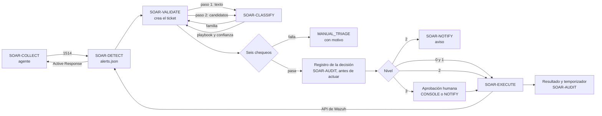

# Kronos AI — Contexto maestro para la redacción de documentos

| Campo | Valor |
| :--- | :--- |
| Código | KRO-CTX-2026-10-14 (propuesto) |
| Versión | 2.1 |
| Fecha | Miércoles 14 de octubre de 2026 |
| Propósito | Entregar a un agente de redacción todo el contexto necesario para escribir la documentación del proyecto hasta antes de instalar los agentes en la farmacia |
| Ubicación sugerida en el repositorio | `docs/00-indice/KRONOS_CONTEXTO_MAESTRO.md` |
| Cambios de la 2.1 | Decisiones D-31 a D-35 (14-10, Nicolás): sólo el equipo aprueba y recibe avisos; plazo de 2 días para aprobar el nivel 3; plazo de revisión de 2 días para el nivel 2 con recordatorio diario y sin reversión automática; propuesta de expiración del nivel 3; aviso a la persona afectada por correo, de forma manual. Actualizadas las secciones 4.5, 4.9, 8.5, 9, 12.3, 13 (KRO-DOC-02, 10 y 17) y 18 |
| Cambios de la 2.0 | Reescrito desde cero. Incorpora el repositorio `soarai2026/kronos-ai` (rama `develop` y ramas de trabajo), los documentos de los otros chats del proyecto («Replanteamiento como SaaS», «Tareas por integrante», catálogo de 25 medidas, casos de uso y plan de instalación en la farmacia) y las respuestas del equipo del 14-10-2026. Reemplaza a las versiones 1.x, que se basaban en documentos de Fase 1 y tenían errores de arquitectura |

> **No confundir:** este archivo es un **contexto para el agente de redacción**. El proyecto tiene además su propio **«Documento Maestro»** (versión 2, con nueve documentos derivados), que se actualiza en el cierre académico. Este archivo no lo reemplaza.

> **Cómo leer los estados**
> - ✅ **Verificado:** hay evidencia en el repositorio, en la salida de una terminal o en un documento del equipo.
> - 🟡 **Informado:** lo dice un documento o una herramienta, pero no se ha comprobado, o la fuente es antigua.
> - ⏳ **Pendiente:** está decidido hacerlo, pero no se ha hecho.
> - ❓ **Por confirmar:** falta el dato. El agente **no lo inventa**: escribe `[POR CONFIRMAR: …]` y lo agrega a la lista de preguntas abiertas.
>
> Este documento no contiene secretos, contraseñas, llaves, tokens, direcciones IP ni datos personales de la farmacia.

---

## Índice

0. Fuentes y orden de precedencia
1. Identidad del proyecto
2. Equipo y forma de trabajo
3. Qué es Kronos
4. Arquitectura actual
5. Evolución: del laboratorio al servicio en la nube
6. Estado actual (al 14-10-2026)
7. Repositorio, CI y convenciones técnicas
8. Planificación y fechas
9. Registro de decisiones
10. Riesgos y brechas
11. Bibliografía y qué capítulos aplican
12. Catálogo de documentos
13. Especificación de cada documento
14. Estructura de carpetas
15. Convenciones de redacción y diseño de los Word
16. Tabla de control de cada documento
17. Insumos disponibles
18. Preguntas abiertas
19. Glosario

---

## 0. Fuentes y orden de precedencia

| # | Fuente | Fecha | Qué aporta |
| :---: | :--- | :--- | :--- |
| F1 | Repositorio `soarai2026/kronos-ai`, rama `develop` (commit `4a0b667`) y ramas `feat/*` | 06 al 14-10-2026 | Código, esquema SQL, CI, prompts, mediciones. Es lo único verificable por inspección |
| F2 | Documento «Kronos AI — Tareas por integrante» | 14-10-2026 | Estado real del servidor, tareas por persona, guía de instalación en 15 partes, decisiones pendientes |
| F3 | Registro de trabajo KRO-LOG-RR-2026-10-08 (Rodrigo) | 08-10-2026 | Despliegue y pruebas de SOAR-AUDIT en el servidor |
| F4 | «Plan de instalación de agentes en la farmacia» | 08-10-2026 | Componentes, seis chequeos, niveles, familias, casos de uso por equipo |
| F5 | «Anexo — Catálogo de medidas (borrador de 25 playbooks)», versión 0.1 | 08-10-2026 | Las 25 medidas con familia, acción y nivel |
| F6 | «Casos de uso y operaciones en los equipos de la farmacia», borrador 0.1 | 07-10-2026 | Qué se instala y qué se recoge en cada equipo; nombres de los documentos firmados |
| F7 | «Kronos AI — Replanteamiento como SaaS» | 25-09-2026 | Decisiones de fondo D1 a D7, arquitectura en la nube, sprints, límites, contingencia, modelo de negocio |
| F8 | Formativa Fase 1 y Guion de la presentación (Drive) | 03-09-2026 | Diseño original del laboratorio, objetivos, ATAM |
| F9 | Respuestas del equipo en este chat | 14-10-2026 | Formato Word, fecha de entrega, región, respaldo, retención, aprobaciones, plazos de los niveles 2 y 3 y aviso a la persona afectada |

**Precedencia ante contradicciones:** F1 (repositorio) > F9 > F2 > F3 > F4 y F5 > F6 > F7 > F8. Toda contradicción se anota.

**Fuentes descartadas** por ser de otro proyecto (práctica en la DGAC): política de retención de Wazuh, catálogo de 104 reglas para Wazuh 4.12, presentación «Ley 21.719 — Solución BD y Frontend» y documentos de la Dirección TIC. No se usan.

---

## 1. Identidad del proyecto

| Campo | Valor | Estado |
| :--- | :--- | :---: |
| Nombre | **Kronos AI** | ✅ |
| Definición en una línea | SOAR con clasificación de incidentes asistida por inteligencia artificial, bajo control determinista, entregado como servicio en la nube y sin dependencia de infraestructura del cliente | ✅ |
| Tipo | Proyecto de título (Capstone, Portafolio de Título Fase 1 APT) | ✅ |
| Institución | DUOC UC, sede Padre Alonso de Ovalle, Santiago. Ingeniería en Informática | ✅ |
| Asignatura | Capstone (sigla PTY4614 según la autoevaluación de Fase 1) | 🟡 |
| Profesor guía | Ceferino Aníbal Sotelo Becerra | ✅ |
| Cliente piloto | Una farmacia. Su nombre y sus datos no se escriben en documentos del repositorio | ✅ |
| Documentos firmados con la farmacia («vía B», en papel) | Autorización de Instalación y Monitoreo; Aviso de Monitoreo a Trabajadores; Aceptación de Acciones de Contención. **No se redactan de nuevo** | ✅ |
| Servidor | **SOAR-CORE-01**: Cloud VDS XL de Contabo provisto por el profesor. 16 vCPU AMD EPYC 7282, 64 GB de RAM, 480 GB NVMe, sin GPU, x86_64 | ✅ (F7) |
| Ubicación del servidor | Francia, Unión Europea | ✅ (F9) |
| Vigencia del contrato del servidor | Hasta el 10 de diciembre de 2026 | 🟡 (F2) |
| Zona horaria del servidor | UTC | ✅ |
| Formato de entrega de los documentos | **Word (.docx)**, con diseño cuidado, en español de Chile | ✅ (F9) |
| Fecha de entrega de los documentos | **Viernes 16 de octubre de 2026** | ✅ (F9) |
| Bibliografía base | Pantaleo, G. y Rinaudo, L. *Ingeniería de Software*. Alfaomega | ✅ |

---

## 2. Equipo y forma de trabajo

### 2.1 Integrantes, capas y componentes que defiende cada uno

| Integrante | Capa | Componentes |
| :--- | :--- | :--- |
| Nicolás Zamora | Detección e infraestructura | SOAR-CORE-01, NetBird, SOAR-DETECT (Wazuh), SOAR-COLLECT (agentes), laboratorio EP-WKS-01 y EP-SRV-01, scripts de Active Response e instaladores |
| Rodrigo Riveros | Persistencia y ejecución | SOAR-AUDIT, SOAR-EXECUTE, SOAR-NOTIFY, SOAR-CONSOLE, respaldo, repositorio y CI |
| Patricio González | Decisión y medición | SOAR-CLASSIFY (Ollama), SOAR-VALIDATE, prompts, catálogo KRO-CAT-01, conjunto de 150 casos etiquetados, medición |

### 2.2 Reglas de trabajo
- **Presentación en los chats con el asistente de IA:** «Hola, soy Nicolás y estoy desde mi notebook» o «… desde mi PC escritorio», «Hola, soy Rodrigo», «Hola, soy Patricio». El asistente revisa «Tareas por integrante» y le dice a cada uno qué le falta.
- **Push diario** a la rama propia, aunque el trabajo esté a medias.
- **Pull request a `develop`** al terminar una tarea, revisado por **otro integrante**, no por el autor.
- **Ningún secreto** en documentos ni en el repositorio. Contraseñas, llaves y tokens van al gestor de contraseñas.
- **Registro de trabajo** por jornada relevante, con código `KRO-LOG-<iniciales>-<AAAA-MM-DD>`, que se sube a `docs/registro/`.
- Las tareas se dan por hechas sólo con evidencia: un commit o PR en GitHub, o la salida de la terminal.

---

## 3. Qué es Kronos

### 3.1 Problema
Los centros de operaciones de seguridad reciben más alertas de las que pueden analizar. Las plataformas SOAR comerciales resuelven eso, pero su licenciamiento es prohibitivo para una PyME, que tiene el mismo volumen de amenazas sin equipo dedicado ni presupuesto. El competidor real de Kronos no es otro SIEM: es la ausencia total de monitoreo.

### 3.2 Tesis
Separación estricta entre una IA que **sólo clasifica** y un código determinista que **ejecuta**, con restricciones verificables y una bitácora encadenada. Si el modelo construyera comandos a partir del texto de una alerta, un atacante que controla ese texto podría ejecutar código (inyección de instrucciones). Por eso el modelo sólo elige un identificador de un catálogo cerrado.

> Frase para la defensa: **COLLECT mira, DETECT reconoce, CLASSIFY opina, VALIDATE decide, EXECUTE actúa, AUDIT recuerda y CONSOLE muestra.** Las únicas piezas que tocan el equipo del cliente son COLLECT y EXECUTE, y ninguna habla con el modelo.

### 3.3 El modelo no aprende
SOAR-CLASSIFY corre con los pesos congelados: sin entrenamiento, sin ajuste fino y sin memoria entre alertas. Un sistema que se reentrena solo no permite reproducir decisiones pasadas y destruye el valor de la bitácora. **Generalizar no es aprender:** el modelo clasifica alertas redactadas de formas que nunca vio, pero no puede inventar una familia ni un playbook. La mejora ocurre por ajuste de prompts, ejemplos en el prompt o ampliación del catálogo como nueva versión del producto, siempre con humano de por medio.

### 3.4 Límites del alcance (F7)
1. **Dos arquetipos de equipo:** puesto de trabajo (Windows) y servidor expuesto (Linux). La escalabilidad se argumenta con el diseño multiinquilino, no instalando muchos agentes.
2. **Nada de datos de pacientes:** Kronos no lee recetas, fichas ni datos médicos, ni el contenido de documentos, correos o bases de datos. Observa comportamiento del sistema operativo.
3. **Cero dependencia de infraestructura del cliente:** sin directorio, sin proxy, sin licencias, sin cuentas privilegiadas en su red y sin abrir puertos entrantes.
4. **Los equipos del proyecto bastan:** si la farmacia entrega equipos, se suman.
5. **La métrica se reporta como es:** la precisión de punta a punta es el producto de los dos pasos (del orden de 64 % con lo medido en el laboratorio). 🟡
6. **Contención sólo donde hay agente.**

### 3.5 Objetivos (Formativa Fase 1, vigentes con ajustes)
- **General:** implementar un sistema SOAR automatizado con IA y ejecución determinista, que garantice trazabilidad y control humano.
- **Específicos:** infraestructura con Wazuh; catálogo de 25 playbooks en 4 niveles de autonomía; modelo local con clasificación en dos pasos; orquestación con limitador de tasa y cortacircuito; persistencia inmutable.
- **Evidencias comprometidas:** cadena de hash verificable; 10 casos adversariales de inyección bloqueados; prueba de estrés de 30 alertas en 10 minutos que active el cortacircuito.

---

## 4. Arquitectura actual

### 4.1 Componentes

| Componente | Qué es | Software | Puerto | Dónde | Estado |
| :--- | :--- | :--- | :--- | :--- | :---: |
| SOAR-COLLECT | Agente en el equipo del cliente | Wazuh Agent 4.14.8, más Sysmon (Windows) o auditd (Linux) | 1514 saliente | Cliente | ⏳ laboratorio: agentes 001 (Linux) y 002 (Windows) activos al 21-10 |
| SOAR-DETECT | Motor de correlación; 15 «reglas de sobre» propias que etiquetan la familia candidata | Wazuh Manager 4.14.8 | 1514, 1515, 55000 | Nube | ✅ instalado |
| Wazuh Indexer y Dashboard | Herramientas internas del equipo; no son multiinquilino y no se muestran al cliente | Wazuh 4.14.8 | 9200, 5601 | Nube | ✅ instalado |
| SOAR-CLASSIFY | Modelo local, dos pasos de prompt, devuelve JSON | Ollama (modelos qwen2.5 3B y 7B medidos; definitivo pendiente) | 11434 interno | Nube | ✅ instalado |
| SOAR-VALIDATE | Validador determinista: seis chequeos, registro previo, falla segura | Python 3.12 + FastAPI | Interno | Nube | ⏳ no existe |
| SOAR-EXECUTE | Ejecutor: traduce el playbook a una orden de Active Response por la API de Wazuh y programa la reversión del nivel 1 | Python, cliente de la API de Wazuh con usuario de permisos mínimos | Interno | Nube | ⏳ no existe |
| SOAR-AUDIT | Base multiinquilino con cadena de hash por inquilino | PostgreSQL 17.11 en Docker | 5432 interno, sin publicar | Nube | ✅ desplegado y probado, base vacía |
| SOAR-CONSOLE | Panel web y API del producto; cola de aprobaciones del nivel 3 y de acciones activas del nivel 2 | FastAPI + HTMX | 443 público con TLS real | Nube | ⏳ no existe |
| SOAR-NOTIFY | Aviso fuera de banda al equipo: nivel 2, aprobación del nivel 3 y recordatorios | Bot de Telegram (y correo transaccional, según F7) | Saliente | Nube | ⏳ no existe |

El servidor corre hoy **cinco contenedores**: indexador, manager y dashboard de Wazuh, Ollama y PostgreSQL. ✅ (F2)

### 4.2 Flujo de una alerta



**Ciclo de SOAR-VALIDATE (F7):** lee una alerta nueva, crea el ticket, arma el prompt del paso 1 y lo envía, recibe la familia, arma el paso 2 sólo con los candidatos de esa familia, recibe el playbook y la confianza, corre los seis chequeos, **escribe la decisión en la bitácora antes de ejecutar** y recién entonces actúa según el nivel.

**Active Response automático del manager:** apagado. Sólo SOAR-EXECUTE dispara acciones, por la API. ⏳ confirmar (F2)

### 4.3 Restricciones R1 a R4

| Regla | Qué dice | Cómo se verifica | Estado |
| :--- | :--- | :--- | :---: |
| R1 | El código de `decision/` no puede importar `ejecucion`, `persistencia` ni `conectores` | Check «R1» del CI con `tools/check_r1.py` (análisis estático de importaciones, incluidas relativas y dinámicas) | ✅ |
| R2 | El catálogo no es extensible en caliente y el modelo no aprende por su cuenta | Por diseño: ampliar el catálogo es una nueva versión | 🟡 (F7) |
| R3 | Registro en la bitácora antes de ejecutar; el camino crítico es código determinista | Orden de las operaciones en VALIDATE y EXECUTE | ✅ (F2) |
| R4 | ❓ No aparece definida en las fuentes revisadas | — | ❓ |

### 4.4 Seis chequeos del validador y falla segura
1. La respuesta del modelo cumple el esquema JSON.
2. La confianza es **mayor o igual a 0,70**.
3. El playbook existe en el catálogo cerrado.
4. El objetivo no está en la **lista de exclusión** (seis categorías, según F7).
5. Los **contadores de tasa** (cinco, según F7) y el **cortacircuito** están en orden.
6. El nivel del playbook está permitido para la **severidad** de la alerta.

Si cualquiera falla, no se ejecuta nada y el ticket queda en `MANUAL_TRIAGE` con el motivo registrado. **Falla segura:** si el modelo no está disponible, tarda demasiado o responde fuera de esquema, Kronos se abstiene y avisa a una persona.

Los motivos de rechazo ya existen en el esquema (`rechazo_motivo`): `ESQUEMA_INVALIDO`, `CONFIANZA_BAJA`, `PLAYBOOK_FUERA_DE_CATALOGO`, `ACTIVO_EXCLUIDO`, `LIMITE_DE_TASA`, `CORTACIRCUITO_ABIERTO`, `NIVEL_NO_PERMITIDO_POR_SEVERIDAD`, `MOTOR_INFERENCIA_NO_DISPONIBLE` y `TIEMPO_EXCEDIDO`. ✅ Si se acepta la propuesta D-34, falta agregar un motivo para la aprobación vencida del nivel 3 (por ejemplo, `APROBACION_VENCIDA`). ⏳

> **Observación para el KRO-PROMPT-01:** el prompt del paso 1 pide no pasar de 0,7 de confianza cuando se aplicó una regla de desempate, y el validador exige ≥ 0,70. Una clasificación con desempate queda justo en el umbral. Conviene documentar si es intencional.

### 4.5 Niveles de autonomía

| Nivel | Qué significa | Ejecución | Reversión | Ejemplo |
| :---: | :--- | :--- | :--- | :--- |
| 0 | Sin impacto | Automática | No aplica | Reunir contexto |
| 1 | Reversible | Automática, con plazo | Sola, al vencer el temporizador | Bloquear por un tiempo una IP externa |
| 2 | Afecta a una persona identificada | Automática, con **aviso inmediato por Telegram** al equipo y **aviso por correo a la persona afectada**, enviado a mano por un integrante (D-35) | Sólo un integrante del equipo; no se revierte sola. **Plazo de revisión: 2 días**; al vencer, recordatorio diario por Telegram y la acción sigue vigente hasta que alguien la revierta (D-33) | Deshabilitar una cuenta local |
| 3 | Afecta la continuidad del servicio | **Nunca sin aprobación previa de un integrante del equipo**; **plazo para aprobar: 2 días** (D-32); quien aprueba queda registrado; rechazar exige justificación | Un integrante del equipo | Aislar un equipo, detener un servicio |

- El nivel es fijo por playbook. El modelo no lo decide: el campo no existe en su contrato de datos.
- La severidad limita los niveles: severidad baja sólo permite el nivel 0; los niveles 2 y 3 se reservan para severidades altas. El mapa exacto: ❓
- El nivel 2 no se revierte solo a propósito: levantar automáticamente la contención de una identidad posiblemente comprometida sería un riesgo. El plazo de 2 días no la revierte; sólo activa los recordatorios.
- **Quién aprueba y recibe avisos:** sólo el equipo Kronos (Nicolás, Rodrigo y Patricio). La farmacia no aprueba ni recibe los avisos de Telegram (D-31).
- **Aviso a la persona afectada:** por correo electrónico, de forma manual, a cargo de un integrante del equipo (D-35). Kronos no envía ese correo automáticamente.
- **Dónde se revisa:** el nivel 3 aparece en Telegram (botones aprobar y rechazar) y en la cola «pendientes de aprobación» de SOAR-CONSOLE; el nivel 2, en el aviso de Telegram y en la lista «acciones activas» de SOAR-CONSOLE, con botón de revertir. El Dashboard de Wazuh no se usa para esto.
- **Nivel 3 sin respuesta en 2 días (Propuesta, D-34):** la aprobación expira sin ejecutar nada, el ticket pasa a `MANUAL_TRIAGE` con motivo de aprobación vencida y se envía un último aviso. `[POR CONFIRMAR: equipo]`

### 4.6 Familias de clasificación (prompt del paso 1, en el repositorio)

| Familia | Qué la define | Niveles posibles (F4) |
| :--- | :--- | :---: |
| F1 Abuso de credenciales | Lo anómalo es la autenticación o el uso de la credencial | 0 a 2 |
| F2 Proceso sospechoso en ejecución | Un programa que se ejecuta y actúa sobre el mismo equipo | 0 a 2 |
| F3 Movimiento lateral o acceso remoto | Un equipo accede a otro o lo controla a distancia | 1 a 3 |
| F4 Exfiltración o salida anómala | Datos o tráfico que salen de forma inusual | 1 a 3 |
| F5 Alteración de integridad o persistencia | Un cambio que queda en el sistema | 1 a 3 |
| F6 Disponibilidad del servicio | Un servicio que cae o se degrada sin alterar datos | 0 a 3 |

El prompt trae **ocho reglas de desempate** en orden (por ejemplo, F1 frente a F3, F2 frente a F5, F4 frente a F6) y una regla de seguridad: el texto de la alerta son datos, y si trae instrucciones se ignoran.

### 4.7 Catálogo de 25 medidas (borrador 0.1, F5)

Siete acciones básicas: aislar el equipo por firewall local, bloquear una IP, terminar un proceso, cerrar la sesión, deshabilitar la cuenta local, detener un servicio y poner un archivo en cuarentena. Tres medidas usan acciones adicionales (limitar conexiones, bloquear un destino de salida y revertir una tarea programada).

| ID | Medida | Nivel | Equipo |
| :--- | :--- | :---: | :--- |
| PB-F1-01 | Reunir contexto de la cuenta y del origen | 0 | Ambos |
| PB-F1-02 | Bloquear la IP externa que intenta entrar | 1 | Ambos |
| PB-F1-03 | Bloquear la IP de otro equipo de la organización que intenta entrar | 2 | Ambos |
| PB-F1-04 | Cerrar la sesión del usuario | 2 | Ambos |
| PB-F1-05 | Deshabilitar la cuenta local | 2 | Ambos |
| PB-F2-01 | Reunir contexto del proceso | 0 | Ambos |
| PB-F2-02 | Poner en cuarentena el archivo del proceso | 1 | Ambos |
| PB-F2-03 | Terminar el proceso | 2 | Ambos |
| PB-F3-01 | Bloquear la IP externa de un acceso remoto sospechoso | 1 | Ambos |
| PB-F3-02 | Bloquear la IP de otro equipo que se mueve entre equipos | 2 | Ambos |
| PB-F3-03 | Aislar un equipo de trabajo por firewall local | 3 | Puesto de trabajo |
| PB-F3-04 | Aislar un servidor por firewall local | 3 | Servidor |
| PB-F4-01 | Bloquear el destino externo de una salida anómala | 1 | Ambos |
| PB-F4-02 | Aislar un equipo de trabajo | 3 | Puesto de trabajo |
| PB-F4-03 | Aislar un servidor | 3 | Servidor |
| PB-F5-01 | Poner en cuarentena el archivo de persistencia | 1 | Ambos |
| PB-F5-02 | Revertir la tarea programada nueva | 1 | Ambos |
| PB-F5-03 | Poner en cuarentena un archivo de sistema o de aplicación alterado | 3 | Ambos |
| PB-F5-04 | Aislar un equipo de trabajo | 3 | Puesto de trabajo |
| PB-F5-05 | Aislar un servidor | 3 | Servidor |
| PB-F6-01 | Reunir contexto de carga y conexiones | 0 | Ambos |
| PB-F6-02 | Bloquear la IP de origen del tráfico abusivo | 1 | Ambos |
| PB-F6-03 | Limitar las conexiones por origen | 1 | Ambos |
| PB-F6-04 | Detener un servicio público del servidor | 3 | Servidor |
| PB-F6-05 | Detener un servicio de apoyo del equipo | 3 | Puesto de trabajo |

Totales: 3 de nivel 0, 8 de nivel 1, 5 de nivel 2 y 9 de nivel 3. ✅ (F5)

**Puntos abiertos del catálogo:** plazos de reversión del nivel 1; si la cuarentena y la reversión de tareas se restauran solas o sólo a mano; implementar o reemplazar las tres acciones adicionales; cómo se ejecutan las consultas de nivel 0; carpeta de cuarentena y su retención; si los playbooks serán de varios pasos (decisión pendiente).

> **Ojo con los identificadores:** el archivo `decision/prompts/paso2_plantilla.txt` del repositorio trae un **catálogo provisional distinto** (tres playbooks genéricos por familia, `PB-F1-01` a `PB-F6-03`) que sólo sirve para medir la inferencia. Los mismos códigos significan cosas distintas en ambos catálogos. El catálogo definitivo **KRO-CAT-01** se define como datos versionados en la etapa 3 y reemplaza a los dos.

### 4.8 Red y puertos

| Puerto | Servicio | Exposición decidida | Estado |
| :--- | :--- | :--- | :---: |
| 22/TCP | SSH | Sólo con llave, sin acceso directo de root | ✅ (servidor endurecido) |
| 1514/TCP | Agentes reportando | Público (es inevitable: los agentes salen por internet) | ⏳ publicar |
| 1515/TCP | Enrolamiento | No se publica: los agentes se registran desde el servidor | ⏳ |
| 55000/TCP | API de Wazuh | Sólo por NetBird | ⏳ |
| 9200/TCP | Indexer | Sólo por NetBird | ⏳ |
| 5601/TCP | Dashboard | Sólo por NetBird | ⏳ |
| 443/TCP | SOAR-CONSOLE | Público, con TLS real y dominio propio | ⏳ |
| 5432/TCP | PostgreSQL | No se publica (red interna de Docker) | ✅ |
| 11434/TCP | Ollama | Interno | ✅ |

Los equipos de la farmacia y las máquinas virtuales del laboratorio **no usan NetBird**: el agente sale por internet al 1514, igual que lo hará un cliente. Falta conseguir un dominio (lo usan los agentes y la consola).

### 4.9 Marco normativo
- **Ley 19.628 modificada por la Ley 21.719:** las modificaciones entran en vigencia el 1 de diciembre de 2026 🟡. La escala de niveles traduce el principio de proporcionalidad; la bitácora con registro previo responde a la responsabilidad proactiva; el nivel 2 exige avisar a la persona afectada por un canal distinto del comprometido. **Ese aviso se hace por correo electrónico, de forma manual, a cargo de un integrante del equipo (D-35).**
- **Ley 21.663, Marco de Ciberseguridad** (revisada en el Diario Oficial el 14-10-2026): **no fija un plazo de conservación de registros**. Su artículo 8, letra b), obliga a los operadores de importancia vital a llevar un registro de las acciones de su sistema de gestión de seguridad, según el reglamento. El artículo 4 incluye la salud entre los servicios esenciales, pero no menciona a las farmacias. 🟡
- **Consecuencia:** la retención de 2 años (D-27) se redacta como decisión interna fundada en la Ley 21.663 y proporcional según la Ley 21.719. No se escribe que la ley exige 2 años ni que la farmacia está obligada por la Ley 21.663.
- Antes de instalar en la farmacia se exigían tres requisitos no técnicos: autorización escrita, aviso a los trabajadores y aceptación explícita de la contención. Están cubiertos por los tres documentos firmados. ✅

### 4.10 Compromisos de arquitectura (ATAM, Fase 1, vigentes)
| Compromiso | Decisión |
| :--- | :--- |
| Seguridad contra latencia | Los dos pasos agregan tiempo; se aceptan mientras el total quede bajo los **60 segundos** comprometidos |
| Autonomía contra contención | El cortacircuito detiene la ejecución automática aunque los incidentes sean reales; un SOAR que contiene sin supervisión es indistinguible de un ataque |

Todas las concesiones apuntan en la misma dirección: seguridad y auditabilidad sobre rendimiento y disponibilidad.

---

## 5. Evolución: del laboratorio al servicio en la nube

### 5.1 Qué cambió y por qué (F7)

| Dimensión | Laboratorio (Fase 1) | Ahora |
| :--- | :--- | :--- |
| Dónde corre | LAB-01, en una casa (VirtualBox sobre Ubuntu 24.04) | SOAR-CORE-01, en la nube |
| Qué instala el cliente | Dominio, proxy y cuatro máquinas virtuales | Un agente, con un script |
| Cómo se contiene | Deshabilitar la cuenta en Active Directory | Acciones locales en el propio equipo, por Active Response |
| Visibilidad de red | Proxy con inspección TLS (Presidio) | Telemetría DNS y de conexiones de Sysmon |
| Interfaz | Dashboard de Wazuh | SOAR-CONSOLE, multiinquilino |
| Aislamiento entre clientes | No existía | `tenant_id` y RLS en toda la base |
| Orquestación | n8n | **FastAPI** (D-03): elimina la pregunta de licencia de n8n y hace verificable R1 |
| Red privada | Tailscale | **NetBird** |

**Salen del alcance:** el controlador de dominio Samba (LAB-AD-01), el proxy con inspección TLS, MailHog, el Dashboard como pantalla del cliente, las cuatro máquinas virtuales (quedan dos endpoints) y el nodo atacante ARES, que no se construye.

### 5.2 Equivalencia de nombres

| Nombre anterior | Nombre actual | Qué es |
| :--- | :--- | :--- |
| ARGOS | SOAR-COLLECT | Agente en el equipo |
| NEMESIS | SOAR-DETECT | Motor de correlación |
| PITIA | SOAR-CLASSIFY | Servicio de inferencia |
| TEMIS | SOAR-VALIDATE | Validador determinista |
| HEFESTO | SOAR-EXECUTE | Orquestador de respuesta |
| MNEMOSINE | SOAR-AUDIT | Registro encadenado |
| AGORA | SOAR-CONSOLE | Consola de operaciones |
| IRIS | SOAR-NOTIFY | Pasarela de notificación |
| HESTIA | EP-WKS-01 | Puesto de trabajo Windows |
| APOLO | EP-SRV-01 | Servidor Linux con servicio |
| ZEUS | LAB-01 | Laboratorio local, congelado como contingencia |
| HERA | LAB-AD-01 | Controlador de dominio, fuera de alcance |
| ARES | — | No se construye |

> **Contradicción conocida:** el guion de Fase 1 presentaba a TEMIS como la interfaz del analista (Django) y a ARGOS como el gateway con Presidio. La tabla de F7, posterior, asigna TEMIS al validador y ARGOS al agente. **Vale la tabla de F7.**

---

## 6. Estado actual (al 14-10-2026)

### 6.1 Servidor SOAR-CORE-01 ✅ (F2)
- Endurecido: usuario sin privilegios con sudo, SSH sólo con llave, sin root directo, firewall que deniega por defecto, fail2ban y actualizaciones automáticas (detalle según F7; confirmar en la parte 01 de la guía).
- Wazuh 4.14.8 (manager, indexador y dashboard en el 5601), Ollama con los modelos medidos y SOAR-AUDIT desplegado y probado.
- Pendiente (Nicolás): reconectar y ordenar NetBird; cambiar las tres contraseñas de Wazuh; confirmar el Active Response automático apagado; `systemctl is-enabled docker`; cerrar el enrolamiento; publicar sólo el 1514; subir `infra/wazuh/docker-compose.yml.example` sin secretos; prueba de reinicio con los cinco contenedores; desactivar el VNC de Contabo cuando no se use.

### 6.2 SOAR-AUDIT ✅ (F1, F3)

**Despliegue:** `/opt/kronos/audit`; PostgreSQL 17.11; red Docker `interna` con `internal: true` (sin salida a internet ni acceso desde el host); `restart: unless-stopped`; secretos generados en el servidor con `generar_secretos.sh` (dueño uid 999, permisos 640 y 400); base recreada y vacía (`count(*) = 0`).

**Tablas (todas con `tenant_id` y RLS forzada):**

| Tabla | Para qué | Notas |
| :--- | :--- | :--- |
| `tickets` | Un ticket por alerta | `execution_status`: `PENDING`, `EXECUTING`, `SUCCESS`, `FAILED`, `REJECTED`, `MANUAL_TRIAGE`. `autonomia_aplicada` 0 a 3. `rechazo_motivo` con 9 valores (4.4). `playbook` y `confianza` |
| `auditoria` | Bitácora encadenada | Sólo inserción. Cadena por `(tenant_id, seq)`. Sin FK a tickets para sobrevivir a cualquier borrado |
| `cola_inferencia` | Cola de trabajo hacia el modelo | Con `intentos`, `disponible_en`, `tomado_por` |
| `temporizadores` | Reversión del nivel 1 y otros vencimientos | `vence_en`, `disparado_en`. Candidata para los plazos de 2 días de los niveles 2 y 3 `[POR CONFIRMAR: Rodrigo]` |
| `cortacircuito` | Transiciones del cortacircuito por ámbito | Sólo inserción; el estado vigente es la fila más reciente |

**Cadena de hash:** SHA-256 de un arreglo JSON canónico (`tenant_id`, `seq`, `ticket_id`, `evento`, `actor`, `detalle`, `creado_en` en UTC con microsegundos) concatenado con `hash_anterior`; el primer eslabón parte de 32 bytes en cero. El trigger asigna `seq`, `hash_anterior`, `creado_en` (`clock_timestamp()`) y `hash` ignorando lo que envíe el cliente, dentro de `pg_advisory_xact_lock` por inquilino. `UNIQUE (tenant_id, seq)` impide bifurcar la cadena.

**Inmutabilidad:** triggers de sentencia rechazan UPDATE, DELETE y TRUNCATE en `auditoria` y `cortacircuito` para todos los roles, superusuario incluido, y siguen activos con `session_replication_role = replica` (`ENABLE ALWAYS`).

**Verificación:** `fn_verificar_cadena(tenant)` devuelve la primera discontinuidad (falta de `seq`, enlace roto o hash que no coincide) o `NULL` si la cadena está íntegra. **Limitación declarada:** sin un ancla externa no se detecta el borrado de las últimas filas; publicar el último hash fuera de la base es tarea pendiente.

**Roles:**
| Rol | Permisos |
| :--- | :--- |
| `kronos_admin` | Superusuario de la base (`POSTGRES_USER`) |
| `kronos_worker` | Servicio de ejecución: lee, inserta y actualiza `tickets`; todo en `cola_inferencia` y `temporizadores`; sólo SELECT e INSERT en `auditoria` y `cortacircuito` |
| `kronos_frontend` | Sólo lectura sobre el esquema `frontend` (vistas `tickets`, `auditoria` y `cortacircuito` filtradas por `app.tenant_id`) |

> **Brecha de diseño para el KRO-DOC-10:** SOAR-CONSOLE debe aprobar el nivel 3, revertir contenciones y operar el cortacircuito, pero `kronos_frontend` es de sólo lectura. Falta decidir si la consola escribe a través de la API de VALIDATE o EXECUTE, o con otro rol.

**Pruebas** (`tests/sql/ejecutar.sh`, como `kronos_worker`), aprobadas en el PC y en el servidor:
| Prueba | Resultado |
| :--- | :--- |
| a) Dos inquilinos en paralelo | 1000/1000 cada uno, cadenas íntegras, 0 filas ajenas, `42501` sobre la cadena del otro |
| b) Un inquilino, 8 conexiones × 100 filas | 800/800, `seq` contiguo, cadena íntegra |
| c) UPDATE, DELETE y TRUNCATE | Rechazados para `kronos_worker` y para el superusuario |
| d) Manipulación en una copia | Detectada: contenido alterado, enlace roto y fila borrada |
| e) Hash independiente de la zona horaria | No existe como prueba permanente (decisión de Rodrigo); verificado una vez 🟡 |

Evidencia: `docs/evidencia/esquema-audit-pruebas-2026-10-08.txt` y `docs/evidencia/esquema-audit-servidor-2026-10-08.txt`.

**Pendiente (Rodrigo):** respaldo en `feat/e2-respaldo` (`pg_dump` diario y restauración probada con la cadena íntegra); guardar los secretos en el gestor; acordar con Patricio la conexión de los servicios y la entrega de contraseñas; capa de acceso a la base para VALIDATE y EXECUTE; ancla externa; si se acepta D-34, agregar el motivo de aprobación vencida.

### 6.3 Capa de decisión ✅ (F1)
- **Prompts:** `decision/prompts/paso1_familia.txt` (familia y confianza) y `decision/prompts/paso2_plantilla.txt` (playbook y confianza, con catálogo provisional). Parte fija al inicio y alerta al final, para reutilizar el prefijo en la caché de Ollama.
- **Medición:** `decision/mediciones/medir_inferencia.py`, sólo biblioteca estándar, contra la API de Ollama con `temperature = 0`, `num_ctx = 4096` y esquema JSON en `format`. Mide cada caso en frío (sin caché) y en tibio. 20 casos ficticios (`casos_prueba.json`: 3 o 4 por familia, tres ambiguos a propósito, IP de documentación y dominios `.example`).
- **Resultados (06-10-2026, CSV en el repositorio):**

| Modelo | Condición | JSON válido | Acierto de familia | Mediana total | Máximo |
| :--- | :--- | :---: | :---: | :---: | :---: |
| qwen2.5 3B | Frío | 20/20 | 16/20 | 27,0 s | 28,6 s |
| qwen2.5 3B | Tibio | 20/20 | 16/20 | 9,8 s | 26,2 s |
| qwen2.5 7B | Frío | 20/20 | 18/20 | 58,1 s | 60,4 s |
| qwen2.5 7B | Tibio | 20/20 | 19/20 | 19,9 s | 55,3 s |

  El 7B en frío queda prácticamente en el límite de 60 s. El modelo definitivo se elige al repetir la medición con Wazuh y PostgreSQL corriendo. ⏳
- **Hoy (14-10):** PR #4 integró la medición a `develop`. La rama `feat/e1-casos-frontera` (sin integrar) agrega 12 casos de frontera (F1/F3, F2/F3, F2/F5 y F4/F6) cuya familia esperada se asignó por la respuesta correcta, no por las reglas actuales, y columnas de confianza en el CSV.
- **Pendiente (Patricio):** reglas de desempate sin ajustarlas sobre los 20 casos ya medidos; modelo definitivo; KRO-CAT-01; SOAR-VALIDATE (seis chequeos, contrato JSON, falla segura); lista de exclusión, contadores, cortacircuito y mapa de severidad; pruebas ESC-04 (inyección) y ESC-05 (motor caído); 150 casos etiquetados y línea base sin IA.

### 6.4 Laboratorio ⏳ (F2)
Con VirtualBox 7, en dos equipos de Nicolás: EP-SRV-01 en su notebook y EP-WKS-01 en su PC de escritorio (en el notebook iba demasiado lenta). Cada máquina usa NAT de VirtualBox y sale por internet al 1514, como lo hará un cliente. El acceso por SSH es con reenvío de puertos hacia `127.0.0.1`: el 2222 hacia EP-SRV-01 (en el notebook) y el 2223 hacia EP-WKS-01 (en el escritorio).
| Equipo | Sistema | Telemetría |
| :--- | :--- | :--- |
| EP-WKS-01 | Windows 11 (ISO build 26300), 4 núcleos, 8 GB, 80 GB, TPM 2.0 y EFI | Sysmon, auditoría de Windows y registro de PowerShell |
| EP-SRV-01 | Ubuntu Server 24.04 con un servicio web y una base de datos | auditd y registros del servicio web y de la base |

El agente se instala sólo dentro de las máquinas virtuales, nunca en el Windows del equipo anfitrión. Grupo propio en Wazuh con su configuración versionada. **Hito de la etapa 1:** F1 y F2 disparan alertas desde el laboratorio.

**Estado al 21-10:** los agentes 001 (EP-SRV-01) y 002 (EP-WKS-01) figuran activos en el manager; en Linux quedaron confirmados de punta a punta el bloqueo de una IP y su reversión automática a los 60 minutos. Falta probar los scripts de Windows de Active Response en EP-WKS-01.

**Nota (21-10):** para que VirtualBox corriera la máquina de Windows, en el PC de escritorio hubo que apagar la integridad de memoria (HVCI) y el hipervisor de Windows. Se revierte al terminar las pruebas con Windows.

### 6.5 Prueba completa en el laboratorio (puerta para la farmacia, F2)
1. Un caso de punta a punta: fuerza bruta, bloqueo de la IP y reversión automática.
2. Los 10 casos de uso del puesto de trabajo y los 12 del servidor.
3. Aprobación del nivel 3 (incluido el vencimiento a los 2 días), recordatorio del nivel 2, cortacircuito y falla segura con el modelo apagado.
4. Prueba de reinicio y restauración del respaldo, con todo funcionando.
5. Cada parte de la guía de instalación leída y seguida por otro integrante.

**Salida a la farmacia:** datos de la farmacia cargados; instalador probado en una VM limpia; retiro probado; recién entonces se instala el agente.

---

## 7. Repositorio, CI y convenciones técnicas

### 7.1 Estructura del repositorio (`develop`)

| Carpeta | Contenido |
| :--- | :--- |
| `decision/` | Motor de decisión: prompts y mediciones (aislado por R1) |
| `validacion/` | Validación de entradas, esquemas y salidas del modelo (vacía) |
| `ejecucion/` | Ejecución de playbooks y acciones (vacía) |
| `persistencia/` | Modelos, migraciones y acceso a datos (vacía) |
| `conectores/` | Conectores con SIEM, EDR y ticketing (vacía) |
| `infra/docker/` | Compose de PostgreSQL, `generar_secretos.sh`, `initdb/` |
| `tests/sql/` | Pruebas a–d del esquema y `ejecutar.sh` |
| `tools/` | `check_r1.py` |
| `docs/` | `evidencia/`; previstas `instalacion/` y `registro/` |

### 7.2 Ramas y versiones
- `main`: estado estable; sólo recibe etapas cerradas, con fusión `--no-ff` y **una etiqueta por etapa** si se cumplió su hito (F7). Hoy sólo tiene los commits iniciales y **ninguna etiqueta**.
- `develop`: integración, por PR revisado.
- `feat/eN-tema`: una rama por tarea; `eN` es la etapa.
- Ramas actuales: `feat/e1-casos-frontera` (abierta), `feat/e1-medicion-inferencia` (integrada), `feat/e1-ci` (integrada), `feat/e1-test-r1` (vacía: falta el test permanente de R1).
- PR integrados: #1 CI, #2 esquema de SOAR-AUDIT, #3 evidencia del servidor (ambos sin revisión cruzada, por decisión de Rodrigo), #4 medición de inferencia.

### 7.3 CI (GitHub Actions, en cada PR a `develop` y `main`) ✅
| Check | Qué hace |
| :--- | :--- |
| gitleaks | Escanea **todo el historial** con gitleaks 8.30.1, instalado verificando su checksum |
| lint (ruff) | `ruff check` con ruff 0.16.10 y Python 3.12, si hay archivos `.py` |
| R1 | `python tools/check_r1.py`: falla si `decision/` importa `ejecucion`, `persistencia` o `conectores` |

Además: `pre-commit` con gitleaks en cada equipo. Mejora pendiente: correr `tests/sql` en el CI con un contenedor de PostgreSQL.

### 7.4 Convenciones observadas
- Commits en español con prefijo de tipo y ámbito: `feat(persistencia): …`, `test(decision): …`, `docs(evidencia): …`, `ci: …`, `chore: …`.
- Nombres de código y de base en español, `snake_case`, funciones SQL con prefijo `fn_`.
- Scripts de shell con `set -euo pipefail` y `umask 077` cuando manejan secretos.
- Datos de prueba ficticios: IP sólo de 192.0.2.0/24 y dominios `.example`.

### 7.5 Qué nunca se sube (`.gitignore` y F7)
`.env`; `*.pem`, `*.key`, llaves SSH; `infra/docker/initdb/03_roles.sql` (va el `.example`); `infra/docker/secrets/`; certificados y usuarios internos de Wazuh (`wazuh_indexer_ssl_certs/`, `internal_users.yml`, `wazuh.yml`); token del bot de Telegram; clave del proveedor de correo; credenciales de la API de Wazuh; tokens de enrolamiento de inquilinos; certificados TLS de SOAR-CONSOLE; clave de admin-emergencia.

### 7.6 Lecciones operativas (F3)
Usar PowerShell normal, no como administrador. Activar NetBird antes de `scp`. Los comandos `gh pr` llevan el número del PR y el merge va aparte, con los checks a la vista. Desplegar sólo lo versionado con `git archive`.

---

## 8. Planificación y fechas

### 8.1 Plan de sprints de F7 (25-09-2026)
| Sprint | Fechas | Objetivo | Hito verificable |
| :--- | :--- | :--- | :--- |
| S1 | 25-09 a 05-10 | Migración de infraestructura | Una alerta de EP-WKS-01 llega a SOAR-DETECT por internet |
| S2 | 06 a 19-10 | Núcleo de decisión | Un ticket de nivel 0 o 1 se resuelve solo, de punta a punta |
| S3 | 20-10 a 02-11 | Respuesta y niveles | Los 25 playbooks con actuador real; una aprobación de nivel 3 funciona |
| S4 | 03 a 16-11 | Capa SaaS | Alguien ajeno instala un agente y ve sus tickets |
| S5 | 17 a 30-11 | Medición y endurecimiento | Precisión de punta a punta medida |
| S6 | 01 a 09-12 | Cierre académico | Tres ensayos cronometrados de la defensa |

### 8.2 Numeración de etapas: **por definir** (D-30)
F7 numeraba las etapas 1 a 10 (las 1 a 4 eran del laboratorio). El repositorio nuevo, creado el 06-10, volvió a empezar en la **etapa 1 «Infraestructura y detección»**, y las fuentes recientes mencionan la **etapa 3** (catálogo KRO-CAT-01) y la **etapa 5** (150 casos y línea base sin IA). El equipo indicó el 14-10 que las etapas están por definir. En los documentos: usar los sprints y los hitos de 8.1 como referencia de calendario y marcar `[POR CONFIRMAR: numeración de etapas]`.

### 8.3 Fechas clave
| Fecha | Qué | Estado |
| :--- | :--- | :---: |
| 16-10-2026 | Entrega de los documentos en Word | ✅ |
| 02-11-2026 | Corte de la vía B (si no había autorización firmada) | Superado: los documentos están firmados |
| 07-11-2026 | **Punto de no retorno:** sin un ticket ejecutado solo contra un equipo real al cerrar S3, se activa la contingencia | 🟡 |
| 01 al 09-12-2026 | Cierre académico y ensayos | 🟡 |
| 10-12-2026 | Fin del contrato del servidor | 🟡 |
| Por definir | Instalación en la farmacia | ❓ |

### 8.4 Plan de contingencia (F7)
Si al 7 de noviembre no se cumple el hito, se presenta el laboratorio local (LAB-01 con Samba y ZEUS) como producto de fase 1, con el trabajo en la nube como prueba de concepto. Para eso LAB-01 y LAB-AD-01 no se tocan. 🟡 (falta confirmar que la etiqueta `v0.4.0-laboratorio` exista en el repositorio anterior)

### 8.5 Decisiones pendientes del equipo (F2)
Fecha de instalación en la farmacia; contingencia al 7 de noviembre; si los playbooks serán de varios pasos; pedir a la farmacia sus datos (equipos, lista de exclusión, contactos y correos para avisar a las personas afectadas). El aprobador del nivel 3 ya no se pide a la farmacia: aprueba el equipo (D-31).

---

## 9. Registro de decisiones

| # | Decisión | Fuente | Estado |
| :---: | :--- | :--- | :---: |
| D-01 | Nube: Cloud VDS XL de Contabo del profesor, pagado durante el proyecto, con acceso de raíz y puertos libres | F7 (D1) | ✅ |
| D-02 | SOAR-CLASSIFY corre en SOAR-CORE-01, modelo local autoalojado, sin API de pago; los datos del cliente no salen de la infraestructura | F7 (D2) | ✅ |
| D-03 | **FastAPI en vez de n8n**: SOAR-VALIDATE se escribe en Python; n8n sale de la arquitectura | F7 (D3) | ✅ |
| D-04 | Dos vías de equipos: vía A, máquinas virtuales propias; vía B, equipos reales de la farmacia como equipos adicionales del mismo inquilino | F7 (D4) | ✅ |
| D-05 | Contención real, sin modo observación | F7 (D5) | ✅ |
| D-06 | LAB-01 se conserva como contingencia y nodo de inferencia de respaldo | F7 (D6) | 🟡 |
| D-07 | Acordar con el profesor por escrito el alcance y los límites | F7 (D7) | 🟡 |
| D-08 | Seis familias por comportamiento observable y clasificación en dos pasos | F1 | ✅ |
| D-09 | Active Response de Wazuh como actuador único, con siete acciones | F7 | ✅ |
| D-10 | Multiinquilino con `tenant_id`, RLS y cadena de hash por inquilino | F1 | ✅ |
| D-11 | Dashboard de Wazuh sólo como herramienta interna, detrás de la red privada | F7 | ✅ |
| D-12 | Red privada del equipo: NetBird (reemplaza a Tailscale) | F2, F3 | ✅ |
| D-13 | SOAR-CORE-01 en UTC | Equipo | ✅ |
| D-14 | 2FA en las cuentas de Contabo descartado por el momento | Nicolás | ✅ (riesgo aceptado) |
| D-15 | Todo se instala primero en la nube y el laboratorio; el agente de la farmacia es lo último | Equipo | ✅ |
| D-16 | Los 2 equipos de laboratorio van en máquinas virtuales de Nicolás, sin NetBird: EP-SRV-01 en su notebook y EP-WKS-01 en su PC de escritorio (cambio del 21-10, porque en el notebook iba muy lenta) | Equipo, F2 | ✅ |
| D-17 | Agentes registrados desde el servidor; 1515 no se publica; 1514 público; 55000, 9200 y 5601 sólo por NetBird | F2 | ✅ (por implementar) |
| D-18 | La guía de instalación va en `docs/instalacion/`, en 15 partes, y cada parte se escribe al instalar su componente y la revisa otro integrante | F2 | ✅ |
| D-19 | Omitir la prueba de regresión «e» del hash | Rodrigo, F3 | ✅ |
| D-20 | PR #2 y #3 integrados sin revisión cruzada (excepción a la regla) | Rodrigo, F3 | ✅ |
| D-21 | Docker Desktop en el PC para pruebas previas | Rodrigo, F3 | ✅ |
| D-22 | Los secretos del servidor se generan allí y no viajan por el repositorio ni por el paquete | Rodrigo, F3 | ✅ |
| D-23 | Documentos de esta entrega en **Word (.docx)**, con diseño cuidado y en español de Chile | F9 | ✅ |
| D-24 | Fecha de entrega: 16-10-2026 | F9 | ✅ |
| D-25 | El servidor está en Francia | F9 | ✅ |
| D-26 | Copia de respaldo fuera del servidor en el **PC de escritorio de Nicolás** | F9 | ✅ con condiciones (R-10) |
| D-27 | Retención inicial de **2 años** para alertas y auditoría, fundada en la Ley 21.663 (decisión interna, ver 4.9) | F9 | ✅ |
| D-28 | Los documentos que requieren datos de la farmacia se redactan **después** de instalar los agentes allí | F9 | ✅ |
| D-29 | Gestor de contraseñas: el equipo respondió «MFA». Falta saber qué gestor guarda los secretos | F9 | ❓ |
| D-30 | Numeración de etapas: por definir | F9 | ⏳ |
| D-31 | **Sólo el equipo Kronos** (Nicolás, Rodrigo y Patricio) aprueba el nivel 3 y recibe los avisos de Telegram de los niveles 2 y 3. La farmacia no aprueba | Nicolás, 14-10 (F9) | ✅ |
| D-32 | **Plazo de 2 días** para aprobar o rechazar una medida de nivel 3 | Nicolás, 14-10 (F9) | ✅ |
| D-33 | **Plazo de revisión de 2 días** para las acciones de nivel 2. Al vencer: recordatorio diario por Telegram y la acción **sigue vigente** hasta que un integrante la revierta. No hay reversión automática (opción A) | Nicolás, 14-10 (F9) | ✅ |
| D-34 | Nivel 3 sin respuesta al vencer los 2 días: expira sin ejecutar, el ticket pasa a `MANUAL_TRIAGE` con motivo de aprobación vencida y se envía un último aviso | Propuesta del asistente de IA, 14-10 | ⏳ Propuesta, por confirmar |
| D-35 | El **aviso a la persona afectada** por una medida de nivel 2 se envía **por correo electrónico, de forma manual**, a cargo de un integrante del equipo | Nicolás, 14-10 (F9) | ✅ |

---

## 10. Riesgos y brechas

| Código | Riesgo o brecha | Estado |
| :--- | :--- | :--- |
| BR-01 | Retención de registros: plazo decidido (2 años, D-27); falta la política escrita, su aprobación, la aplicación en el indexador y cómo se elimina al vencer | Abierta, avanzada |
| BR-05 | Acuerdo de tratamiento de datos con el proveedor. El servidor es del profesor, en Francia: el acuerdo con Contabo lo debe aceptar el titular de la cuenta, y los datos salen de Chile (transferencia internacional). F2 incluye pedirle al profesor el DPA | Abierta |
| R-01 | No existe respaldo de SOAR-AUDIT ni de la configuración de Wazuh, sus certificados y `client.keys` | Abierto |
| R-02 | No se ha comprobado que Docker y los cinco contenedores vuelvan solos tras un reinicio | Abierto |
| R-03 | Sin prueba permanente de que el hash no depende de la zona horaria | Aceptado |
| R-04 | PR integrados sin revisión cruzada | Aceptado puntualmente |
| R-05 | Secretos del servidor no recuperables si no se guardan en el gestor | Abierto |
| R-06 | Rodrigo tiene un rol elevado en NetBird | Abierto |
| R-07 | Cuentas de Contabo sin 2FA | Aceptado (D-14) |
| R-08 | El modelo 7B queda en el límite de 60 s en frío; con todos los servicios corriendo puede superarlo | Abierto |
| R-09 | La auditoría es inmutable, pero la retención exige eliminar al vencer: hay que definir cómo se expira una cadena append-only | Abierto |
| R-10 | La copia de respaldo, con datos de clientes reales, queda en un PC personal (D-26). Mitigaciones propuestas: cifrar en el servidor antes de salir, con la llave fuera de ese PC; traerla por NetBird; disco cifrado; acceso sólo de Nicolás; restauración probada | Abierto |
| R-11 | Plazo corto (16-10) para el volumen de documentos | Abierto |
| R-12 | Sin el gateway de Fase 1 no hay detección de fuga de datos en el tráfico; se compensa en parte con DNS y conexiones de Sysmon | Aceptado |
| R-13 | `kronos_frontend` es de sólo lectura y la consola necesita escribir aprobaciones y reversiones | Abierto (diseño) |
| R-14 | Sin ancla externa no se detecta el borrado de las últimas filas de la bitácora | Abierto |
| R-15 | El contrato del servidor termina el 10-12-2026; falta definir qué pasa con los datos de la farmacia después | Abierto |
| R-16 | La contención sólo opera donde hay agente | Límite declarado |

---

## 11. Bibliografía y qué capítulos aplican

**Referencia:** Pantaleo, G. y Rinaudo, L. *Ingeniería de Software*. Alfaomega. (Año y edición: tomarlos de la portada.)

| Capítulo | Tema | ¿Aplica? | Uso en Kronos |
| :--- | :--- | :---: | :--- |
| 1 y 3 | Evolución; paradigmas | No | — |
| 2 | Condiciones de trabajo | Parcial | 2.4, buenas prácticas: trabajo iterativo, entregables frecuentes, integración frecuente |
| 4 | Metodologías | Sí | Justificación metodológica |
| 5 | Metodologías conducidas por planes | Sí | 5.9 plan de proyecto; 5.10.1 configuración; 5.10.2 calidad; 5.11.1 arquitectura |
| 6 | Metodologías ágiles | Sí | Sprints, prácticas y flujo de trabajo |
| 7 a 9 | UML | Sí, como diagramas | Componentes, despliegue, clases, casos de uso, actividades, secuencia y estados |
| 10 y 11 | Relevamiento y análisis de requerimientos | Sí | Casos de uso, priorización, trazabilidad |
| 12 | Pruebas a los requerimientos | Sí | Validación, verificación, casos de prueba |
| 13 | Arquitectura | Sí | Vista estática, componentes, atributos de calidad, pruebas a la arquitectura |
| 14 | Diseño | Sí | Patrones, persistencia, conexión con sistemas externos, servicios web |
| 15 | Métricas | Sí | 15.4 estándares y chequeos de estilo; métricas |
| 16 y 17 | Pruebas; proceso de pruebas | Sí | 17.1 plan; 17.2 automatización; 17.3 integración continua |
| 18 | Estimación y planificación | Sí | Estimación y planificación ágil; 18.7 cuestionario de relevamiento |
| 19 y 21 | Monitoreo, control y cierre | Sí | Seguimiento por sprint; cierre |
| 20 | Planificación del caso testigo | Sí | 20.3 metodología ágil; 20.7 visión del proyecto |
| 22 y 24 | Calidad; plan de calidad | Sí | Validación y verificación; objetivos de calidad |
| 23 | Área de calidad de una empresa | No | — |
| 25 | ISO 9001 y CMMI | Referencia | Se citan como marco, no se certifica |
| 26 | Conclusiones | Al final | Cierre |

---

## 12. Catálogo de documentos

### 12.1 Documentos que ya existen (no se redactan de nuevo)

| Documento | Estado | Qué hacer |
| :--- | :--- | :--- |
| Tres documentos firmados con la farmacia | Firmados en papel | Citarlos por su nombre |
| «Replanteamiento como SaaS» (F7) | Decisión de fondo | Fuente; las decisiones D1 a D7 entran a los documentos |
| «Tareas por integrante» (F2) | Documento vivo | Fuente de estado |
| «Casos de uso y operaciones en los equipos de la farmacia» (F6) | Borrador 0.1 | Se completa después de la farmacia (D-28) |
| «Anexo — Catálogo de medidas» (F5) | Borrador 0.1 | Base del KRO-DOC-12 |
| «Plan de instalación de agentes en la farmacia» (F4) | Versión del 08-10 | Se completa después de la farmacia (D-28) |
| Documento Maestro (v2) y sus nueve documentos derivados | Existen; ubicación ❓ | Se actualizan en el cierre académico (S6); no son parte de esta entrega |
| Registros de trabajo | Uno subido al Proyecto (F3) | Copiarlos a `docs/registro/` |

### 12.2 Documentos a redactar para el 16-10-2026 (en Word)

| N° | Código | Documento | Base bibliográfica | Responsable | Prioridad |
| :---: | :--- | :--- | :--- | :--- | :---: |
| 00 | KRO-DOC-00 | Índice documental y matriz de trazabilidad | — | Equipo | P1 |
| 01 | KRO-DOC-01 | Visión de la solución | 20.7 | Equipo | P1 |
| 02 | KRO-DOC-02 | Especificación de requerimientos | 10.2; caps. 11 y 12; 9.3 | Patricio | P1 |
| 03 | KRO-DOC-03 | Justificación metodológica | Caps. 4 y 6; 2.4 | Patricio | P2 |
| 04 | KRO-DOC-04 | Estimación y planificación | Caps. 18 y 20.3; 5.9 | Patricio | P2 |
| 05 | KRO-DOC-05 | Plan de administración de la configuración | 5.10.1 | Rodrigo | P2 |
| 06 | KRO-DOC-06 | Plan de calidad | 5.10.2; caps. 22 y 24 | Patricio | P2 |
| 07 | KRO-DOC-07 | Plan de métricas y medición | Cap. 15; 22.2 | Patricio | P3 |
| 08 | KRO-DOC-08 | Seguimiento y control (informe de avance y registros) | Caps. 19 y 21 | Equipo | P3 |
| 09 | KRO-DOC-09 | Documento de arquitectura | Cap. 13; 8.5; 8.6; 5.11.1 | Nicolás y Rodrigo | P1 |
| 10 | KRO-DOC-10 | Documento de diseño | Cap. 14; caps. 8 y 9 | Rodrigo y Patricio | P2 |
| 11 | KRO-DOC-11 | Especificación de prompts (KRO-PROMPT-01) | 14.1.2 (apoyo) | Patricio | P2 |
| 12 | KRO-DOC-12 | Catálogo de playbooks (KRO-CAT-01), versión de trabajo | — | Patricio | P3 |
| 13 | KRO-DOC-13 | Estándares de codificación | 15.4 | Rodrigo | P1 |
| 14 | KRO-DOC-14 | Proceso de integración continua | 17.2; 17.3 | Rodrigo | P1 |
| 15 | KRO-DOC-15 | Plan de pruebas de software | Cap. 16; 17.1; 12.3 | Nicolás y Patricio | P2 |
| 16 | KRO-DOC-16 | Casos de prueba y plan de aceptación en el laboratorio | 12.2; 12.3 | Nicolás | P3 |
| 17 | KRO-DOC-17 | Seguridad de la plataforma | 13.2.3 (apoyo) | Rodrigo | P1 |
| 18 | KRO-DOC-18 | Cierre de brechas BR-01 y BR-05 | — | Rodrigo y Nicolás | P3 |
| 19 | KRO-DOC-19 | Política de respaldo y retención | — | Rodrigo | P2 |
| 20 | KRO-DOC-20 | Procedimiento de gestión de secretos | — | Rodrigo | P2 |
| 21 | KRO-DOC-21 | Guía de instalación (`docs/instalacion/`, 15 partes) | 8.6 (apoyo) | Cada uno su parte | P2 |
| 22 | KRO-DOC-22 | Cierre del proyecto | 21.1.2; cap. 26 | Equipo | P4, sólo esqueleto |

**Prioridades:** P1 define el producto o lo pidió el equipo como pendiente explícito. P2 lo completa. P3 depende de decisiones abiertas. P4 se completa al final.

### 12.3 Pospuestos hasta después de instalar en la farmacia (D-28)
- Relevamiento con los datos de la farmacia (equipos, cuentas, servicios críticos, lista de exclusión, direcciones permitidas, contactos y correos para el aviso a las personas afectadas, horarios, carpetas vigiladas, plazos de reversión, sitios no permitidos y contactos de emergencia). El aprobador del nivel 3 ya no es un dato de la farmacia (D-31).
- Versiones finales de «Casos de uso y operaciones» y del «Plan de instalación de agentes en la farmacia».
- Partes 13 (alta de un cliente) y 14 (retiro) de la guía, en lo que dependa de la farmacia.

### 12.4 Documentos futuros (no son de esta entrega)
Documento de medición sobre los 150 casos (S5); modelo de negocio (S6); entregable en inglés del indicador 12 (S6); banco de 100 preguntas (S6); actualización del Documento Maestro y sus derivados (S6).

### 12.5 Límites entre documentos que se parecen
- **05 Configuración:** qué se versiona, ramas, etiquetas, líneas base y control de cambios. **13 Estándares:** cómo se escribe el código. **14 CI:** qué corre en cada PR y qué bloquea el merge.
- **09 Arquitectura:** el porqué y las vistas. **10 Diseño:** cómo funciona cada componente por dentro. **21 Guía:** los comandos.
- **11 Prompts:** el contrato con el modelo. **12 Catálogo:** las medidas. El 10 los referencia, no los repite.
- **17 Seguridad:** amenazas y controles. **20 Secretos:** ciclo de vida de cada credencial. El 17 resume y remite al 20.
- **18 Brechas:** retención de alertas y bitácora, y acuerdo con el proveedor. **19 Respaldo:** las copias. Se remiten entre sí.
- **15 Plan de pruebas:** estrategia. **16 Casos:** cada caso y la puerta de salida a la farmacia.

---

## 13. Especificación de cada documento

#### KRO-DOC-00 · Índice documental y matriz de trazabilidad
Lista de documentos (código, ruta, responsable, versión, estado); documentos existentes de 12.1; matriz documento ↔ capítulo de la bibliografía; matriz objetivo específico ↔ requerimiento ↔ componente ↔ prueba ↔ evidencia; enlaces a `preguntas-abiertas.md` y `pendientes-farmacia.md`.

#### KRO-DOC-01 · Visión de la solución
Problema; definición en una línea; tesis y frase de la defensa (3.2); características salientes (catálogo cerrado, niveles, bitácora verificable, multiinquilino, sólo un agente en el cliente); los seis límites (3.4); qué hace y qué no hace (F4); contexto (Capstone, servidor del profesor en la UE, leyes); partes interesadas; supuestos y restricciones; evolución desde Fase 1 en un párrafo con la tabla 5.1.

#### KRO-DOC-02 · Especificación de requerimientos
Actores (encargado del cliente, integrante del equipo Kronos que aprueba el nivel 3, revisa el nivel 2 y avisa por correo a la persona afectada, persona afectada, agente, sistema); requerimientos funcionales `RF-NN` por componente, incluidos los plazos de 2 días de los niveles 2 y 3 y el recordatorio diario (D-32, D-33); no funcionales `RNF-NN` (seguridad, latencia ≤ 60 s, auditabilidad, aislamiento por inquilino, falla segura, disponibilidad tras reinicio); legales `RL-NN`, incluido el aviso por correo a la persona afectada (D-35); R1 a R4 como restricciones de diseño (con su nombre, no como ID de requerimiento); casos de uso del sistema con diagrama (alerta resuelta en nivel 1, aprobación de nivel 3, aprobación de nivel 3 vencida, revisión y reversión de nivel 2, rechazo por chequeo, cortacircuito, verificación de cadena, alta de inquilino); estados del ticket y del cortacircuito; priorización MoSCoW; lista de verificación SaaS de F7 como criterios; trazabilidad. Los casos de uso por equipo de la farmacia (CU-C01 a CU-C10 y CU-S01 a CU-S12) se citan como escenarios de los arquetipos, sin datos de la farmacia.

#### KRO-DOC-03 · Justificación metodológica
Por qué un enfoque ágil por sprints con hitos verificables (y no cascada); separación por capas para trabajar en paralelo; prácticas (push diario, PR revisado, una etiqueta por etapa, registros de trabajo, evidencia por tarea); cómo se adaptó Scrum y XP a un equipo de tres; riesgos que la metodología mitiga; comparación con las metodologías del capítulo 4.

#### KRO-DOC-04 · Estimación y planificación
Sprints S1 a S6 con fechas e hitos (8.1); estado de cada hito al 14-10; numeración de etapas `[POR CONFIRMAR]`; tareas por integrante y dependencias («bloquea a …», F2); fechas clave (8.3); punto de no retorno y contingencia (8.4); estimación de esfuerzo `[POR CONFIRMAR]` si no hay datos; reparto por capas.

#### KRO-DOC-05 · Plan de administración de la configuración
Ítems de configuración (código, esquema SQL, compose, prompts y esquemas JSON, catálogo KRO-CAT-01 como datos, reglas y decodificadores de Wazuh, scripts de Active Response, instaladores, conjunto de 150 casos, documentos, evidencia); ramas y etiquetas (7.2); control de cambios con PR y revisión cruzada, y registro de excepciones (D-20); qué nunca se sube (7.5); despliegue con `git archive`; configuración del servidor (UTC, `/opt/kronos/<componente>`, `.example` versionados y reales fuera del repositorio); el conjunto etiquetado versionado y fechado como evidencia de que la medición no se ajustó después.

#### KRO-DOC-06 · Plan de calidad
Objetivos medibles: 100 % de PR con los tres checks en verde y revisados por otro integrante; 0 secretos en el historial; cadena íntegra en toda verificación; latencia ≤ 60 s; 10 de 10 casos adversariales bloqueados; cortacircuito activo con 30 alertas en 10 minutos; los 15 criterios de la lista de verificación SaaS con su sprint. Actividades de aseguramiento, validación y verificación, responsables, registros de calidad y tratamiento de no conformidades. ISO 9001 y CMMI sólo como referencia.

#### KRO-DOC-07 · Plan de métricas y medición
Por métrica: definición, fórmula, fuente, frecuencia, umbral y responsable. Producto: latencia por paso y total (frío y tibio), JSON válido, acierto del paso 1, acierto del paso 2, **precisión de punta a punta** (producto de los pasos), tasa de rechazo por chequeo, activaciones del cortacircuito, tiempo de verificación de la cadena, tiempo de aprobación del nivel 3 y de revisión del nivel 2 frente al plazo de 2 días. Proceso: PR por sprint, checks fallidos, PR sin revisión, tareas bloqueadas. Incluir los resultados del 06-10 (6.3) como línea base, la línea base sin IA (tabla fija) prevista y el método con 150 casos etiquetados.

#### KRO-DOC-08 · Seguimiento y control
Plantilla de registro de trabajo (basada en KRO-LOG-RR-2026-10-08); plantilla de informe de avance por sprint; **informe de avance al 14-10** (sección 6); registro de decisiones (sección 9) y de riesgos (sección 10); procedimiento para `docs/registro/`.

#### KRO-DOC-09 · Documento de arquitectura
Vistas: contexto, componentes (4.1), despliegue (servidor, contenedores, puertos y NetBird de 4.8, laboratorio, cliente) y flujo de una alerta (4.2). Frontera decisión/ejecución y su verificación (R1). Atributos de calidad priorizados con escenarios. Compromisos ATAM. Decisiones de arquitectura en formato breve (contexto, decisión, consecuencias): D-01 a D-05, D-09 a D-12, D-17, UTC y base sin puertos publicados. Pruebas a la arquitectura (R1 en el CI, prueba de reinicio, aislamiento por inquilino). Evolución desde el laboratorio (sección 5).

#### KRO-DOC-10 · Documento de diseño
SOAR-AUDIT completo (6.2); SOAR-VALIDATE (ciclo, seis chequeos, motivos de rechazo, falla segura, lectura de `alerts.json`, cola de inferencia); SOAR-EXECUTE (traducción playbook → Active Response, usuario de API de permisos mínimos, temporizadores de reversión, contrato con el agente ⏳); SOAR-NOTIFY (Telegram sólo al equipo, D-31; aviso de nivel 2 y recordatorio diario al vencer los 2 días, D-33; aprobación de nivel 3 con plazo de 2 días, D-32, y su expiración según la propuesta D-34); aviso a la persona afectada por correo manual, fuera de Kronos (D-35); SOAR-CONSOLE (autenticación, cola de pendientes de aprobación, lista de acciones activas de nivel 2 con su antigüedad, línea de tiempo, aprobación, reversión, cortacircuito, botón de verificar cadena, descarga del instalador); cómo se llevan los plazos (tabla `temporizadores` u otra) `[POR CONFIRMAR]`; conexión de los servicios a la base y entrega de contraseñas `[POR CONFIRMAR]`; brecha R-13; diagramas: entidad-relación, secuencia de una alerta, estados del ticket (incluida la aprobación vencida), estados del cortacircuito.

#### KRO-DOC-11 · Especificación de prompts (KRO-PROMPT-01)
Paso 1: definiciones de F1 a F6, ocho reglas de desempate y su orden, criterio de confianza, regla de seguridad y esquema de salida `{"familia","confianza"}`. Paso 2: marcadores `{{familia}}`, `{{condiciones}}` y `{{alerta}}`, reglas de elección y esquema `{"playbook_id","confianza"}`. Parámetros (`temperature = 0`, `num_ctx = 4096`, esquema en `format`). Diseño para la caché (parte fija al inicio). Defensa contra inyección. Cómo se cambian los prompts (versión, medición contra los casos, sin ajustar sobre los casos ya medidos). Observación del umbral 0,7 (4.4).

#### KRO-DOC-12 · Catálogo de playbooks (KRO-CAT-01), versión de trabajo
Las 25 medidas (4.7) con familia, acción, nivel, equipo, efecto en la persona y reversión (F5); reglas que valen para todas, incluidos los plazos de los niveles 2 y 3 (D-32, D-33) y el aviso por correo a la persona afectada en el nivel 2 (D-35); puntos abiertos; aclaración del catálogo provisional de medición; formato previsto como datos versionados. Rotular como **versión de trabajo**: el definitivo se cierra en la etapa 3.

#### KRO-DOC-13 · Estándares de codificación
Python 3.12 y ruff (reglas `[POR CONFIRMAR]` si no hay configuración); FastAPI (routers, modelos Pydantic para los contratos, manejo de errores, OpenAPI) como propuesta; SQL (nombres en español, `snake_case`, prefijo `fn_`, comentarios de intención como en `02_esquema.sql`); shell (`set -euo pipefail`, `umask 077` con secretos; ShellCheck como propuesta); Docker Compose (sin puertos publicados, secretos por archivo, red interna); commits (7.4); R1 como regla de dependencia; datos de prueba ficticios. Separar **observado** de **propuesto**.

#### KRO-DOC-14 · Proceso de integración continua
Flujo rama → PR → checks → revisión de otro integrante → merge a `develop` → etapa cerrada a `main` con etiqueta; los tres checks (7.3) con sus versiones; pre-commit con gitleaks; qué bloquea el merge; lecciones de los comandos `gh`; test permanente de R1 pendiente; `tests/sql` en el CI pendiente; métricas del CI.

#### KRO-DOC-15 · Plan de pruebas de software
Alcance; niveles (unitarias, integración, sistema, aceptación); tipos (funcionales, adversariales de inyección ESC-04, motor de inferencia caído ESC-05, estrés 30 alertas en 10 minutos, regresión, reinicio, restauración del respaldo, aislamiento por inquilino, vencimiento de los plazos de los niveles 2 y 3, Atomic Red Team en S5); ambientes (PC con Docker Desktop, SOAR-CORE-01, laboratorio); pruebas existentes (a–d, medición de 20 casos, 12 casos de frontera) y faltantes; criterios de entrada y salida; «hasta cuándo probar»; datos de prueba ficticios; evidencia en `docs/evidencia/`.

#### KRO-DOC-16 · Casos de prueba y plan de aceptación en el laboratorio
Casos con ID, requerimiento que verifica, precondiciones, pasos, resultado esperado, resultado obtenido y evidencia. Incluir a–d (✅), «e» (no existe), las pruebas controladas por familia de F5 (por ejemplo, cinco intentos de inicio de sesión con un usuario inexistente para F1, un PowerShell codificado inofensivo para F2), el vencimiento de los plazos (con un plazo acortado para la prueba) y la prueba completa de 6.5 como **puerta de salida a la farmacia**, con quién da el visto bueno. Casos adversariales descritos por técnica, sin cargas dañinas.

#### KRO-DOC-17 · Seguridad de la plataforma
Activos; modelo de amenazas (inyección de instrucciones, abuso de volumen, compromiso del servidor, agente apagado por el atacante, robo de tokens de enrolamiento, acceso no autorizado a la consola, a la API de Wazuh o a NetBird, filtración de secretos, alteración de la bitácora, robo de la cuenta de Telegram de un aprobador); controles (R1 a R4, seis chequeos, lista de exclusión, contadores y cortacircuito, bitácora inmutable con verificación, RLS, roles mínimos, puertos de 4.8, NetBird, servidor endurecido, Active Response sólo desde EXECUTE, gitleaks en el historial, aprobación sólo por el equipo con plazo, D-31 a D-33); latido y ticket por agente caído; gestión de accesos (Contabo sin 2FA como riesgo aceptado, VNC, roles de NetBird); respuesta ante incidentes de la propia plataforma; matriz de cumplimiento de las leyes 21.719 y 21.663 como borrador, incluido el aviso por correo a la persona afectada (D-35); riesgos residuales (sección 10).

#### KRO-DOC-18 · Cierre de brechas BR-01 y BR-05
**BR-01:** qué se conserva (alertas en el indexador, archivos del manager, bitácora); 2 años como decisión interna (4.9); quién aprueba y cuándo se revisa; aplicación en el indexador; eliminación al vencer y conciliación con la bitácora inmutable (R-09, plantear opciones sin decidir); qué pasa con los datos al terminar el servicio o el contrato (R-15). **BR-05:** el servidor es del profesor y está en Francia; el acuerdo de tratamiento lo acepta el titular de la cuenta; transferencia internacional; medidas del proveedor; pasos pendientes. **Borrador técnico** que requiere revisión del profesor o de una asesoría legal.

#### KRO-DOC-19 · Política de respaldo y retención
Qué se respalda (SOAR-AUDIT; configuración de Wazuh, certificados y `client.keys`; compose y `.example`); `pg_dump` diario con temporizador de systemd; restauración probada con `restaurar_prueba.sh` y verificación de la cadena; si el trigger se dispara al restaurar, `--disable-triggers` y su justificación; copia fuera del servidor en el PC de escritorio de Nicolás con las condiciones de R-10, rotuladas «Propuesta», dejando constancia de que se aparta del criterio anterior de no usar PC personales; frecuencias y retención de las copias (propuesta); monitoreo; RPO y RTO propuestos; prueba de reinicio.

#### KRO-DOC-20 · Procedimiento de gestión de secretos
Inventario **sin valores** (superusuario de la base; `kronos_worker` y `kronos_frontend`; tres contraseñas de Wazuh; usuario de la API de Wazuh para EXECUTE; token de Telegram; clave del correo; tokens de enrolamiento; certificados TLS; clave de admin-emergencia; NetBird; panel de Contabo); generación en el servidor; permisos y dueños; resguardo en el gestor de contraseñas `[POR CONFIRMAR: cuál]` y MFA en las cuentas (D-29); entrega a cada componente `[POR CONFIRMAR]`; rotación; revocación; respuesta ante filtración (un secreto que entró al historial se rota aunque se borre); prohibiciones.

#### KRO-DOC-21 · Guía de instalación
Formato de la guía (decisión D-18): **Markdown en `docs/instalacion/`**, una parte por archivo; además se entrega una compilación en Word para el 16-10.

| N.º | Parte | Archivo | Responsable | Qué puede redactar el agente |
| :---: | :--- | :--- | :--- | :--- |
| 00 | Índice, orden de instalación y convenciones | `README.md` | Rodrigo | Completa |
| 01 | Servidor, endurecimiento y NetBird | `01-servidor.md` | Nicolás | Estructura, versiones y verificaciones; comandos `[POR CONFIRMAR]` |
| 02 | Docker y Wazuh: manager, indexador y dashboard | `02-wazuh.md` | Nicolás | Ídem |
| 03 | Laboratorio en máquinas virtuales | `03-laboratorio.md` | Nicolás | Ídem, con las especificaciones de 6.4 |
| 04 | Agente en Windows: Sysmon, auditoría y PowerShell | `04-agente-windows.md` | Nicolás | Esqueleto |
| 05 | Agente en Linux: auditd | `05-agente-linux.md` | Nicolás | Esqueleto |
| 06 | Ollama y modelos | `06-ollama.md` | Patricio | Estructura y parámetros; comandos `[POR CONFIRMAR]` |
| 07 | SOAR-AUDIT (PostgreSQL) | `07-soar-audit.md` | Rodrigo | **Completa**, desde el registro F3 y el repositorio |
| 08 | SOAR-VALIDATE | `08-soar-validate.md` | Patricio | Esqueleto |
| 09 | SOAR-EXECUTE y respuestas activas | `09-soar-execute.md` | Rodrigo y Nicolás | Esqueleto |
| 10 | SOAR-NOTIFY | `10-soar-notify.md` | Rodrigo | Esqueleto |
| 11 | SOAR-CONSOLE y TLS | `11-soar-console.md` | Rodrigo | Esqueleto |
| 12 | Respaldo y restauración | `12-respaldo.md` | Rodrigo y Nicolás | Esqueleto con la política del KRO-DOC-19 |
| 13 | Alta de un cliente e instalación en sus equipos | `13-alta-cliente.md` | Patricio | Esqueleto; lo de la farmacia, pospuesto |
| 14 | Retiro de Kronos de un equipo | `14-retiro.md` | Nicolás | Esqueleto; lo de la farmacia, pospuesto |

**Reglas de redacción de la guía (F2):** cada comando lleva su rótulo **[PC]**, **[servidor]** o **[VM]**; después de cada paso, qué debe mostrar la pantalla; versiones exactas (Wazuh 4.14.8, PostgreSQL 17.11, Ubuntu 24.04); ningún secreto: contraseñas, llaves y claves se escriben `XXXX`; sin IP reales. **El agente no inventa comandos** que no estén en el repositorio o en un registro de trabajo.

#### KRO-DOC-22 · Cierre del proyecto
Sólo esqueleto: resultados contra objetivos, evidencias, lecciones aprendidas, trabajo futuro (aprendizaje con humano en el ciclo, correlación de incidentes, casos donde la IA agrega valor según F4) y conclusiones por integrante.

---

## 14. Estructura de carpetas

```
docs/
├── 00-indice/
│   ├── README.md                    (índice navegable en GitHub)
│   ├── KRONOS_CONTEXTO_MAESTRO.md
│   ├── preguntas-abiertas.md
│   └── pendientes-farmacia.md
├── entregables/                     (los Word de la entrega)
│   ├── KRO-DOC-00_indice.docx
│   ├── KRO-DOC-01_vision.docx
│   └── …
├── instalacion/                     (guía en Markdown, KRO-DOC-21)
│   ├── README.md
│   ├── 01-servidor.md
│   └── …
├── diagramas/                       (fuente .mmd e imagen .png)
├── evidencia/                       (ya existe)
└── registro/                        (registros de trabajo)
```

Nombre de los Word: `KRO-DOC-NN_tema-en-minusculas.docx`.

---

## 15. Convenciones de redacción y diseño de los Word

### 15.1 Redacción
1. Español de Chile, técnico y formal. Frases cortas. Voz activa cuando se pueda.
2. Tablas para datos comparables; listas sólo cuando aclaran; diagramas en Mermaid, insertados como imagen.
3. Leyenda de estados ✅ 🟡 ⏳ ❓ al inicio de cada documento. Lo que sólo se informó no se presenta como verificado.
4. **Nada inventado:** cada dato faltante va como `[POR CONFIRMAR: qué falta — preguntar a <integrante>]` y a `preguntas-abiertas.md`. Lo que dependa de la farmacia va como `[PENDIENTE: posterior a la instalación en la farmacia]` y a `pendientes-farmacia.md`.
5. Lo propuesto se rotula «Propuesta».
6. Coherencia: un mismo hecho se escribe igual en todos los documentos, usando los nombres SOAR-* y los códigos de este archivo. Ante una contradicción, se aplica la precedencia de la sección 0 y se anota.
7. Cada documento que se apoya en el libro lo cita con capítulo y sección. No se copia texto del libro.
8. Sin contraseñas, llaves, tokens, IP reales, usuarios del servidor ni datos que identifiquen a la farmacia o a su personal.
9. Los contenidos legales son borradores técnicos y lo dicen. No se atribuyen a una ley plazos que no fija.
10. Sin relleno ni repetición: se remite por código («ver KRO-DOC-20») y se respetan los límites de 12.5.

### 15.2 Diseño de los Word
Una **plantilla común** que se construye primero y se reutiliza:
- **Portada:** Kronos AI, título y código del documento, versión, fecha, integrantes, profesor guía, DUOC UC, sede y carrera.
- **Página 2:** tabla de control (sección 16) e historial de versiones.
- **Índice automático** (y de figuras y tablas cuando haya más de tres).
- **Estilos reales de Word** para títulos y cuerpo.
- Tipografía sobria (por ejemplo, Calibri o Aptos 11 pt), interlineado 1,15, márgenes de 2,5 cm.
- Un color institucional más grises, igual en todos los documentos.
- **Encabezado** con «Kronos AI» y el código; **pie** con «Página X de Y» y «Uso interno».
- Tablas con encabezado sombreado y repetido en cada página, bordes finos y filas alternadas.
- Figuras y tablas numeradas, con título.
- Comandos en fuente monoespaciada sobre fondo gris claro.
- Marcadores `[POR CONFIRMAR]` y `[PENDIENTE]` resaltados.
- Bibliografía al final, en formato APA.

---

## 16. Tabla de control de cada documento

```markdown
| Campo | Valor |
| :--- | :--- |
| Código | KRO-DOC-NN |
| Proyecto | Kronos AI — SOAR con clasificación asistida por IA bajo control determinista |
| Versión | 0.1 (borrador) |
| Fecha | AAAA-MM-DD |
| Autor | <integrante> (redacción asistida por IA) |
| Revisor | <otro integrante> |
| Estado | Borrador / En revisión / Aprobado |
| Base bibliográfica | Pantaleo y Rinaudo, cap. X |

| Versión | Fecha | Autor | Cambios |
| :--- | :--- | :--- | :--- |
| 0.1 | AAAA-MM-DD | <nombre> | Primera versión |
```

---

## 17. Insumos disponibles

| Insumo | Dónde |
| :--- | :--- |
| Repositorio | `github.com/soarai2026/kronos-ai` (privado), rama `develop` |
| Tareas por integrante | enlace privado del equipo |
| Replanteamiento como SaaS | enlace privado del equipo |
| Anexo — Catálogo de medidas (25 playbooks) | enlace privado del equipo |
| Plan de instalación de agentes en la farmacia | enlace privado del equipo |
| Casos de uso y operaciones en los equipos de la farmacia | enlace privado del equipo |
| Registro KRO-LOG-RR-2026-10-08 | Proyecto «Capstone» del asistente de IA |
| Formativa Fase 1, Guion, presentación, MOCKUP de la consola | Google Drive del equipo |
| Plantilla DUOC «Plan de Pruebas de Software» (de otra asignatura) | Google Drive; guía opcional para el KRO-DOC-15 |

Los enlaces del asistente de IA son privados de la cuenta del equipo. Si el agente no puede abrirlos, este archivo contiene lo necesario.

**Mencionados, pero no ubicados:** el Documento Maestro v2 y sus nueve derivados; la matriz de trazabilidad de objetivos; la matriz de cumplimiento de la Ley 21.719; las 15 reglas de sobre; el conjunto de 150 casos etiquetados; los 10 casos adversariales; la rúbrica de la entrega.

---

## 18. Preguntas abiertas

| # | Pregunta | Estado |
| :---: | :--- | :--- |
| 1 | ¿La rúbrica exige documentos o secciones específicas? | ❓ El formato ya está decidido (Word) |
| 2 | Numeración y nombre de las etapas | ⏳ Por definir (D-30) |
| 3 | ¿Qué define la restricción R4? | ❓ |
| 4 | ¿Cuál es el mapa de severidad de Wazuh a niveles permitidos? | ❓ Patricio |
| 5 | ¿Cuáles son las seis categorías de exclusión y los cinco contadores de tasa, con sus umbrales? | ❓ Patricio |
| 6 | ¿Qué gestor de contraseñas guarda los secretos? (la respuesta fue «MFA») | ❓ Equipo |
| 7 | ¿Cómo escribe SOAR-CONSOLE las aprobaciones y reversiones si `kronos_frontend` es de sólo lectura? | ❓ Rodrigo |
| 8 | ¿Cómo se conectan los servicios a PostgreSQL y cómo reciben sus contraseñas? | ⏳ Rodrigo y Patricio |
| 9 | ¿Cómo lee SOAR-VALIDATE las alertas de Wazuh? | ⏳ Nicolás y Patricio |
| 10 | ¿Qué modelo queda como definitivo? | ⏳ Patricio |
| 11 | ¿Se aceptan las condiciones de R-10 para el respaldo en el PC de Nicolás? | ❓ Equipo |
| 12 | ¿El profesor aceptó el acuerdo de tratamiento de datos de Contabo? | ❓ Nicolás |
| 13 | ¿Existe la etiqueta `v0.4.0-laboratorio` y sigue vigente la contingencia con LAB-01? | ❓ Equipo |
| 14 | ¿Dónde está el Documento Maestro v2? | ❓ Equipo |
| 15 | ¿Qué pasa con los datos de la farmacia al terminar el contrato del servidor (10-12)? | ❓ Equipo |
| 16 | Datos de la farmacia (12.3) | Pospuesta (D-28) |
| 17 | ¿Se acepta la propuesta D-34 (nivel 3 vencido expira sin ejecutar, pasa a `MANUAL_TRIAGE` y se agrega el motivo de aprobación vencida)? | ❓ Equipo |

---

## 19. Glosario

| Término | Significado |
| :--- | :--- |
| SOAR | Plataforma de orquestación, automatización y respuesta ante incidentes de seguridad |
| SIEM | Sistema que recolecta y correlaciona eventos de seguridad (Wazuh) |
| SOC | Centro de operaciones de seguridad |
| SOAR-COLLECT … SOAR-NOTIFY | Componentes de Kronos (sección 4.1) |
| EP-WKS-01 / EP-SRV-01 | Puesto de trabajo Windows y servidor Linux de prueba |
| Playbook o medida | Respuesta predefinida y auditada del catálogo cerrado |
| Familia | Tipo de incidente por comportamiento observable (F1 a F6) |
| Nivel de autonomía | Grado de automatización de una medida (0 a 3), fijo en el catálogo |
| Plazo de aprobación / de revisión | 2 días para aprobar el nivel 3 y para revisar una acción de nivel 2 (D-32, D-33) |
| Lista de exclusión | Equipos, programas, servicios y cuentas sobre los que Kronos nunca actúa |
| Cortacircuito | Interruptor que detiene toda acción automática; una vez abierto, sólo una persona lo cierra |
| Falla segura | Ante modelo caído, demora, baja confianza o salida fuera del catálogo, no se actúa y el caso pasa a una persona |
| Reglas de sobre | Reglas propias de Wazuh que etiquetan la familia candidata sobre las reglas nativas |
| Active Response | Mecanismo de Wazuh por el que el manager ordena al agente ejecutar un script |
| Inquilino (*tenant*) | Cliente cuyos datos están aislados del resto (`tenant_id` y RLS) |
| RLS | Seguridad a nivel de fila de PostgreSQL |
| Cadena de hash | Cada registro incluye el hash del anterior; una alteración rompe la cadena |
| Ancla externa | Copia del último hash fuera de la base, para detectar el borrado de las últimas filas |
| Frío / tibio | Medición sin y con reutilización de la caché de prompts de Ollama |
| HITL | Supervisión humana en el ciclo |
| ATAM | Método de análisis de compromisos de arquitectura |
| NetBird | Red privada en malla del equipo |
| gitleaks / ruff | Detector de secretos / analizador de estilo de Python |
