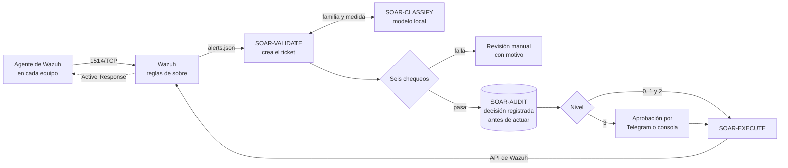

# Kronos AI

Kronos AI es una plataforma **SOAR** (orquestación, automatización y respuesta de seguridad) para pequeñas y
medianas empresas que no tienen un especialista en ciberseguridad. Vigila los equipos de la empresa con Wazuh,
clasifica cada alerta con un modelo de lenguaje que corre en el propio servidor y responde con medidas
reversibles: bloquear una IP, deshabilitar una cuenta o aislar un equipo. 

El encargado de TI de la PyME recibe avisos en lenguaje claro por Telegram y sólo interviene cuando hace falta
criterio humano: aprobar una medida de alto impacto o revertir una que ya se aplicó. Kronos corre en un servidor
en la nube (Contabo, con Docker) y se valida en una PyME simulada: un puesto con Windows 11 y un servidor con
Ubuntu, atacados con siete escenarios reproducibles e inofensivos.

Proyecto de título (Capstone) de Ingeniería en Informática, Duoc UC, 2026, de Nicolás Zamora, Rodrigo Riveros y
Patricio González.

[English summary](#english-summary)

## Cómo está organizado este repositorio

El repositorio sigue las fases del proyecto de título. En cada fase hay tres carpetas: los **avances** (lo que
se construyó), la **documentación individual** de cada integrante y la **documentación grupal**.

```text
kronos-ai/
├── Fase 1/                         Definición del proyecto (agosto y septiembre de 2026)
│   ├── Avances/                    Resumen del diseño original, el laboratorio y los objetivos
│   ├── Documentación Individual/   Autoevaluaciones y diarios de reflexión
│   └── Documentación Grupal/       Definición del proyecto, Formativa Fase 1 y presentación
├── Fase 2/                         Desarrollo de Kronos en la nube (desde el 25-09-2026)
│   ├── Avances/                    El proyecto completo: código, infraestructura, pruebas y documentación técnica
│   ├── Documentación Individual/   Documentos de cada integrante
│   └── Documentación Grupal/       Los 31 documentos del proyecto, el informe final y el manual del encargado de TI
└── README.md                       Este archivo
```

| Busco… | Está en |
| :--- | :--- |
| El código de Kronos y cómo correr sus pruebas | [`Fase 2/Avances`](Fase%202/Avances/) |
| La guía de instalación paso a paso, en 15 partes | [`Fase 2/Avances/docs/instalacion`](Fase%202/Avances/docs/instalacion/) |
| Los 31 documentos, el informe final y el manual | [`Fase 2/Documentación Grupal`](Fase%202/Documentaci%C3%B3n%20Grupal/) |
| Los diagramas de arquitectura | [`Fase 2/Avances/docs/diagramas`](Fase%202/Avances/docs/diagramas/) |
| Las evidencias de las pruebas | [`Fase 2/Avances/docs/evidencia`](Fase%202/Avances/docs/evidencia/) |
| Cómo se llevó el proyecto: registros, actas, planes y decisiones | [`Fase 2/Avances/docs/registro`](Fase%202/Avances/docs/registro/) |
| Qué cambió en cada versión | [`Fase 2/Avances/CHANGELOG.md`](Fase%202/Avances/CHANGELOG.md) |
| Cómo trabaja el equipo: ramas, revisiones y despliegue | [`.github/CONTRIBUTING.md`](.github/CONTRIBUTING.md) |
| Lo que se hizo en la Fase 1 | [`Fase 1`](Fase%201/) |

## El problema

- Una PyME enfrenta las mismas amenazas que una empresa grande: robo de credenciales, ransomware, accesos
  remotos indebidos. Pero no puede pagar un especialista en ciberseguridad ni un centro de operaciones de
  seguridad (SOC).
- Quien se ocupa de la tecnología suele ser un **encargado de TI generalista** (soporte, cuentas, redes y
  equipos), sin tiempo ni formación para analizar alertas de seguridad.
- Si hay monitoreo, sus alertas no se atienden. Lo más común es que no lo haya, y que el incidente se note por
  sus efectos. Las plataformas SOAR comerciales resuelven esto con licencias que una PyME no puede pagar.

## La solución

| Paso | Qué hace Kronos |
| :--- | :--- |
| **Detecta** | Wazuh 4.14.8 con 15 reglas propias («reglas de sobre») que etiquetan seis familias de incidentes |
| **Clasifica** | Un modelo local (qwen2.5:7b en Ollama) propone la familia y la medida. Los datos de la PyME no salen a una IA externa |
| **Decide** | Seis chequeos deterministas. Si alguno falla, o el modelo no responde, Kronos no actúa: el caso pasa a revisión manual (falla segura) |
| **Responde** | Medidas reversibles por Active Response de Wazuh, con un usuario de API que tiene un solo permiso |
| **Avisa** | Avisos por Telegram y una consola web para aprobar, rechazar y revertir |
| **Recuerda** | Bitácora multiinquilino de sólo inserción, con cadena de hash por inquilino |

> **La IA sólo clasifica; el código determinista ejecuta.** El modelo elige un identificador de un catálogo
> cerrado y nunca construye comandos. Si un atacante escribe instrucciones dentro de una alerta, lo peor que
> consigue es una clasificación equivocada, y los chequeos la detienen.

## Para quién es

| Encargado de TI de la PyME | |
| :--- | :--- |
| Quién es | Una persona que hace «de todo» en tecnología: sabe de equipos y redes, no de ciberseguridad |
| Qué necesita | Saber qué pasó, qué hizo Kronos y si tiene que hacer algo, en lenguaje claro y desde el teléfono |
| Qué hace en Kronos | Lee los avisos de Telegram, aprueba o rechaza las medidas de nivel 3, revisa y revierte las de nivel 2 en la consola, y avisa por correo a la persona afectada |
| Qué no tiene que hacer | Leer registros, escribir reglas, elegir la medida ni ejecutar comandos |

## Cómo funciona



1. El agente de cada equipo envía sus eventos al manager de Wazuh por el puerto 1514, el único puerto público
   de Kronos.
2. Una regla de sobre reconoce el patrón del ataque y etiqueta la alerta con su familia candidata y su severidad.
3. SOAR-VALIDATE lee la alerta, le quita la etiqueta para que el modelo opine por su cuenta y le pide dos
   respuestas en JSON: la familia y, dentro de ella, la medida.
4. Seis chequeos revisan la propuesta: formato, confianza y coincidencia con la regla de sobre, catálogo, lista
   de exclusión, cortacircuito y contadores, y nivel permitido para la severidad.
5. La decisión queda en la bitácora antes de que nadie actúe. SOAR-EXECUTE envía la orden por la API de Wazuh y
   el script `kronos-*` del agente la aplica.
6. SOAR-NOTIFY avisa por Telegram. SOAR-CONSOLE, sólo por la red privada del equipo, permite aprobar, rechazar,
   revertir y cerrar el cortacircuito.

| Nivel | Qué hace Kronos | Cómo se revierte | Ejemplo |
| :-: | :--- | :--- | :--- |
| 0 | Reúne contexto, sin impacto | No aplica | Revisar el historial de inicios de sesión |
| 1 | Ejecuta solo | Sola, a los 60 minutos | Bloquear la IP externa que intenta entrar |
| 2 | Ejecuta y avisa al encargado de TI | Una persona, desde la consola | Bloquear un equipo interno; deshabilitar una cuenta local |
| 3 | Pide aprobación por Telegram o en la consola; si nadie responde en 2 días, no se ejecuta | Una persona, desde la consola | Aislar un puesto de trabajo |

El nivel lo fija el catálogo, nunca el modelo, y la severidad de la alerta le pone un tope. El detalle técnico
(componentes, seguridad, familias, limitaciones, instalación y pruebas) está en
[`Fase 2/Avances`](Fase%202/Avances/).

## Estado de la versión 1.0

| Qué | Evidencia |
| :--- | :--- |
| Flujo completo con alertas reales: ataque → Wazuh → IA → decisión → bloqueo → reversión | Ticket 20 (20-10) y reversión a los 60 minutos y 3 segundos (21-10) |
| Clasificación: qwen2.5:7b acierta 19 de 20 casos originales; 18 de 18 alertas reales coinciden con su regla, y 0 de 10 inyecciones logran su objetivo | [Mediciones](Fase%202/Avances/decision/mediciones/resultados/) |
| Base multiinquilino con cadena de hash; respaldo cifrado y restauración probada | 2822 de 2822 eventos, 12 inquilinos y 0 cadenas rotas (15-10) |
| Avisos y aprobación por Telegram; consola con contraseña y TOTP | Grupo del equipo con verificación en dos pasos (21-10) |
| Calidad del código | 319 pruebas unitarias y 65 de integración, que el CI corre en cada cambio, y 4 pruebas SQL de la base |

Medidas que se ejecutan de verdad en la v1.0: bloquear una IP (niveles 1 y 2, en Linux y Windows), deshabilitar
una cuenta local (nivel 2, Windows) y aislar un puesto de trabajo (nivel 3, Windows). Si la IA elige otra medida
del catálogo, Kronos no toca el equipo y el caso termina en falla segura con aviso.

## Equipo

| Integrante | Rol Scrum | A cargo de |
| :--- | :--- | :--- |
| Nicolás Zamora | Product Owner | Servidor y red, detección (Wazuh y reglas de sobre), agentes, laboratorio y scripts de Active Response |
| Rodrigo Riveros | Scrum Master | Persistencia (SOAR-AUDIT), ejecución, notificación, consola, respaldo, despliegue y CI |
| Patricio González | Equipo de desarrollo | IA (SOAR-CLASSIFY), validación, catálogo, mediciones y calidad de la decisión |

Cómo trabajamos (ramas `develop` y `main`, revisión cruzada, regla de merge y despliegue):
[`.github/CONTRIBUTING.md`](.github/CONTRIBUTING.md). Para reportar un problema de seguridad:
[`.github/SECURITY.md`](.github/SECURITY.md).

## Licencia

Proyecto académico. Mientras no se publique una licencia (decisión D-63), el código queda con todos los derechos
reservados por sus autores.

## English summary

**Kronos AI** is a cloud-hosted SOAR (Security Orchestration, Automation and Response) platform for small
businesses that cannot afford a cybersecurity specialist and rely on a general IT person. Wazuh agents on each
computer send events to a central server, where 15 custom rules tag every alert with one of six incident
families.

A language model running locally on the server (qwen2.5:7b on Ollama) classifies each alert in two steps: first
the family, then the response. The model **only picks an identifier from a closed catalog of 25 measures**; it
never writes commands. Deterministic code checks the proposal six ways and fails safe, sending the case to manual
review, if any check fails or the model is down. Approved measures run through Wazuh Active Response;
high-impact ones wait for the IT person's approval on Telegram or in a web console. Every step is recorded in an
append-only PostgreSQL log with a per-tenant hash chain.

The repository follows the phases of the degree project: `Fase 1` (project definition) and `Fase 2`
(development), each with progress (`Avances`), individual documents and group documents. The working system
lives in `Fase 2/Avances`. It is a Capstone project in Computer Engineering at Duoc UC (Chile), 2026, by Nicolás
Zamora, Rodrigo Riveros and Patricio González.
