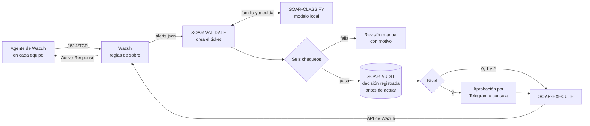

# Kronos AI

**El analista de ciberseguridad que la PyME no puede contratar.**

Kronos AI es un SOAR en la nube para PyMEs que no tienen un especialista en ciberseguridad. Recibe las alertas de Wazuh y las clasifica con un modelo de lenguaje que corre en el propio servidor. Luego decide con reglas deterministas y un catálogo cerrado de 25 medidas, aplica respuestas reversibles y deja cada paso en una bitácora encadenada. El encargado de TI de la PyME interviene sólo donde hace falta criterio humano, y siempre tiene la última palabra.

Proyecto de título (Capstone) de Ingeniería en Informática, DUOC UC, 2026. Se valida en una PyME simulada: un puesto Windows 11 y un servidor Ubuntu.

[English summary](#english-summary)

## El problema

- Una PyME enfrenta las mismas amenazas que una empresa grande: robo de credenciales, ransomware, accesos remotos indebidos. Pero no puede pagar un especialista en ciberseguridad ni un centro de operaciones de seguridad (SOC).
- Quien se ocupa de la tecnología suele ser un **encargado de TI generalista** (soporte, cuentas, redes y equipos), sin tiempo ni formación para analizar alertas de seguridad.
- Si hay monitoreo, sus alertas no se atienden. Lo más común es que no lo haya, y que el incidente se note por sus efectos. Las plataformas SOAR comerciales resuelven esto con licencias que una PyME no puede pagar.

## La solución

| Paso | Qué hace Kronos |
| :--- | :--- |
| **Detecta** | Wazuh 4.14.8 con 15 reglas propias («reglas de sobre») que etiquetan seis familias de incidentes |
| **Clasifica** | Un modelo local (qwen2.5:7b en Ollama) propone la familia y la medida. Los datos de la PyME no salen a una IA externa |
| **Decide** | Seis chequeos deterministas. Si alguno falla, o el modelo no responde, Kronos no actúa: el caso pasa a revisión manual (falla segura) |
| **Responde** | Medidas reversibles por Active Response de Wazuh, con un usuario de API que tiene un solo permiso |
| **Avisa** | Avisos por Telegram y consola web para aprobar, rechazar y revertir |
| **Recuerda** | Bitácora multiinquilino de sólo inserción, con cadena de hash por inquilino |

> **La IA sólo clasifica; el código determinista ejecuta.** El modelo elige un identificador de un catálogo cerrado y nunca construye comandos. Si un atacante escribe instrucciones dentro de una alerta, lo peor que consigue es una clasificación equivocada, y los chequeos la detienen.

## Para quién es

| Encargado de TI de la PyME | |
| :--- | :--- |
| Quién es | Una persona que hace «de todo» en tecnología: sabe de equipos y redes, no de ciberseguridad |
| Qué necesita | Saber qué pasó, qué hizo Kronos y si tiene que hacer algo, en lenguaje claro y desde el teléfono |
| Qué hace en Kronos | Lee los avisos de Telegram, aprueba o rechaza las medidas de nivel 3, revisa y revierte las de nivel 2 en la consola, y avisa por correo a la persona afectada |
| Qué no tiene que hacer | Leer registros, escribir reglas, elegir la medida ni ejecutar comandos |

## Cómo funciona



1. El agente de cada equipo envía sus eventos al manager de Wazuh por el puerto 1514. Ese es el único puerto público de Kronos.
2. Una regla de sobre (100101 a 100115) reconoce el patrón y etiqueta la alerta con su familia candidata (`kronos_f1` a `kronos_f6`) y su severidad.
3. SOAR-VALIDATE lee `alerts.json` en sólo lectura y le quita la etiqueta, para que el modelo opine por su cuenta. Luego le pide dos respuestas en JSON: la familia y, dentro de ella, la medida.
4. Los seis chequeos, en orden: respuesta dentro del esquema; confianza ≥ 0,70 y familia igual a la de la regla de sobre; medida del catálogo, de esa familia y del ámbito de la IP; objetivo fuera de la lista de exclusión; cortacircuito cerrado y contadores de tasa bajo su tope; nivel permitido para la severidad.
5. La decisión queda en la bitácora antes de que nadie actúe. SOAR-EXECUTE envía la orden por la API de Wazuh y el script `kronos-*` del agente la aplica. Las reversiones quedan programadas.
6. SOAR-NOTIFY avisa por Telegram. SOAR-CONSOLE, sólo por la red privada NetBird, permite aprobar, rechazar, revertir y cerrar el cortacircuito.

### Niveles de autonomía

El nivel lo fija el catálogo, nunca el modelo, y la severidad de la alerta le pone un tope: severidad 0 a 6 → nivel 0; 7 a 9 → 1; 10 y 11 → 2; 12 a 15 → 3.

| Nivel | Qué hace Kronos | Cómo se revierte | Ejemplo |
| :-: | :--- | :--- | :--- |
| 0 | Reúne contexto, sin impacto | No aplica | Revisar el historial de inicios de sesión |
| 1 | Ejecuta solo | Sola, al vencer el plazo de 60 minutos | Bloquear la IP externa que intenta entrar |
| 2 | Ejecuta y avisa al encargado de TI | Una persona, desde la consola. A los 2 días sin revisar, recordatorio diario | Bloquear un equipo interno; deshabilitar una cuenta local |
| 3 | Pide aprobación por Telegram o en la consola, con plazo de 2 días. Si nadie responde, no se ejecuta | Una persona, desde la consola | Aislar un puesto de trabajo |

### Familias de incidentes

| Familia | Qué la define | Reglas de sobre |
| :--- | :--- | :--- |
| F1 Abuso de credenciales | La autenticación o el uso de una credencial | 100101 a 100103: fuerza bruta por SSH, fallos de PAM o sudo, fallos de inicio de sesión en Windows |
| F2 Proceso sospechoso | Un programa que se ejecuta y actúa en el mismo equipo | 100104 a 100106: PowerShell codificado, ejecución sospechosa, ejecutable en carpeta temporal |
| F3 Movimiento lateral o acceso remoto | Un equipo accede a otro o lo controla a distancia | 100107 y 100108: RDP o NTLM de red, PsExec, WinRM |
| F4 Exfiltración o salida anómala | Datos o tráfico que salen de forma inusual | 100109: binario sospechoso con conexión de salida |
| F5 Alteración o persistencia | Un cambio que queda en el sistema | 100110 a 100113: archivo vigilado, cuenta nueva, tarea o cron, registro de auditoría borrado |
| F6 Disponibilidad | Un servicio que cae o se degrada sin alterar datos | 100114 y 100115: disco lleno, agente detenido |

## Componentes

| Componente | Qué hace | Tecnología | Código |
| :--- | :--- | :--- | :--- |
| SOAR-COLLECT | Agente en cada equipo de la PyME; aplica las medidas | Wazuh Agent 4.14.8 | [`infra/wazuh/active-response/`](infra/wazuh/active-response/) |
| SOAR-DETECT | Correlación y reglas de sobre | Wazuh Manager 4.14.8 | [`infra/wazuh/`](infra/wazuh/) |
| SOAR-CLASSIFY | Clasificación en dos pasos | Ollama 0.40.0 y qwen2.5:7b, sin GPU | [`decision/`](decision/), [`infra/ollama/`](infra/ollama/) |
| SOAR-VALIDATE | Lee las alertas, consulta el modelo, aplica los chequeos y registra la decisión | Python 3.12 | [`validacion/`](validacion/), [`conectores/`](conectores/) |
| SOAR-EXECUTE | Órdenes de Active Response y reversiones | Python 3.12, API de Wazuh | [`ejecucion/`](ejecucion/) |
| SOAR-NOTIFY | Avisos y aprobaciones | API de bots de Telegram | [`notificacion/`](notificacion/) |
| SOAR-CONSOLE | Panel web: aprobar, rechazar, revertir, cerrar el cortacircuito | FastAPI, HTML sin JavaScript, TOTP | [`consola/`](consola/) |
| SOAR-AUDIT | Tickets y bitácora multiinquilino, con RLS y cadena de hash | PostgreSQL 17.11 | [`persistencia/`](persistencia/), [`infra/docker/`](infra/docker/) |

Todo corre en **SOAR-CORE-01**, un Cloud VDS de Contabo (16 vCPU, 64 GB de RAM, sin GPU) con Docker, en Francia y en hora UTC. La API de Wazuh, el indexador, el dashboard y la consola sólo escuchan en la red privada NetBird del equipo.

## Seguridad por diseño

- **El modelo no actúa.** EXECUTE toma el comando de una tabla fija y valida cada argumento (IP, cuenta, servicio). Nunca actúa sobre el manager, la IP del propio equipo ni cuentas como `root` o `Administrator`.
- **Resistencia a la inyección.** En las mediciones, ninguno de los 10 ataques de inyección consiguió que qwen2.5:7b eligiera la familia que buscaba. Además, si la familia del modelo no coincide con la de la regla de sobre, el caso va a revisión manual (`FAMILIA_NO_COINCIDE`).
- **Falla segura.** Un modelo caído, una demora sobre el plazo o una respuesta fuera del esquema llevan a revisión manual, nunca a una acción.
- **Mínimo privilegio.** Cada pieza tiene una identidad propia con lo justo: el usuario de API `kronos-execute` sólo puede `active-response:command`; los servicios se conectan como `kronos_worker`; la consola, como `kronos_console`, sólo puede llamar a cuatro funciones de la base.
- **Bitácora inalterable.** `UPDATE`, `DELETE` y `TRUNCATE` se rechazan, incluso para el superusuario, y cada evento encadena el hash del anterior.
- **Freno ante inundaciones.** El cortacircuito detiene toda acción automática con 30 alertas en 10 minutos y sólo una persona lo vuelve a cerrar. Los contadores de tasa limitan las acciones por PyME, por equipo y por medida.
- **Datos personales acotados.** La alerta completa se guarda aparte, con tope de 64 KiB, y se purga a los 90 días; la bitácora conserva sólo su huella.
- **Sin secretos en el repositorio.** gitleaks revisa todo el historial en cada PR. Las claves viven como secretos de Docker en el servidor y en el gestor de contraseñas del equipo.

## Estado de la versión 1.0

Verificado en el servidor y en la PyME simulada:

| Qué | Evidencia |
| :--- | :--- |
| Flujo completo con alertas reales en Linux: ataque → Wazuh → IA → decisión → bloqueo → reversión | Ticket 20 (20-10) y reversión a los 60 minutos y 3 segundos (21-10). [Registro](docs/registro/) |
| Clasificación: qwen2.5:7b con 19 de 20 casos originales y 18 de 18 alertas en formato real coinciden con su regla; 0 de 10 inyecciones logran su objetivo | [`decision/mediciones/resultados/`](decision/mediciones/resultados/) |
| Base multiinquilino con cadena de hash; respaldo diario cifrado con age y restauración probada | 2822 de 2822 eventos, 12 inquilinos y 0 cadenas rotas (15-10) |
| Avisos y aprobación por Telegram; consola con contraseña y TOTP | Grupo con los tres integrantes y verificación en dos pasos (21-10) |
| Calidad del código | 308 pruebas unitarias, 63 de integración y 4 pruebas SQL; ruff y regla R1 en el CI |

Medidas con actuador real en la v1.0. Las demás medidas del catálogo siguen ahí: si la IA elige una, el ticket termina en falla segura con aviso.

| Medida | Nivel | Linux | Windows |
| :--- | :-: | :--- | :--- |
| Bloquear la IP externa que intenta entrar | 1 | `iptables` | Firewall de Windows |
| Bloquear la IP de otro equipo de la organización | 2 | `iptables` | Firewall de Windows |
| Deshabilitar la cuenta local | 2 | — | `net user` |
| Aislar un puesto de trabajo | 3 | — | Firewall de Windows, salvo el canal con el manager |

### Limitaciones conocidas

- Un solo servidor, sin alta disponibilidad. La continuidad se apoya en el respaldo diario cifrado y la restauración probada.
- Kronos sólo contiene donde hay agente.
- En Linux, una regla de bloqueo no sobrevive al reinicio del equipo y nadie la vuelve a aplicar (D-52).
- Si el agente está apagado cuando vence una reversión, ésta falla y no se reintenta. Queda el aviso para hacerla a mano (D-51).
- La confianza que declara el modelo no separa aciertos de errores. El control fuerte es la coincidencia con la regla de sobre.
- PB-F6-04 y PB-F6-05 (nivel 3) no se alcanzan: las reglas F6 tienen severidad 7, que permite como máximo el nivel 1.
- F4 (exfiltración) tiene una sola regla de sobre.
- La meta es decidir en 60 segundos. En la prueba real del 20-10 tomó 11 s; con el modelo cargado, cada alerta toma unos 20 s. VALIDATE espera hasta 120 s antes de abstenerse.

## Instalación

Se necesita un servidor Linux con Docker y NetBird, y el agente de Wazuh 4.14.8 en cada equipo de la PyME. La **guía de instalación paso a paso, en 15 partes**, está en [`docs/instalacion/`](docs/instalacion/): servidor, NetBird, Docker, Wazuh y reglas, Ollama, base y servicios, Active Response, agentes, Telegram, respaldo, alta y retiro de una PyME, y verificación de punta a punta.

Para trabajar en el código basta con Python 3.12:

```bash
python -m venv .venv && source .venv/bin/activate
pip install -r persistencia/requirements.txt -r consola/requirements.txt httpx
python -m unittest discover -s tests/unit
```

## Pruebas

| Tipo | Cantidad | Cómo se corren |
| :--- | :--- | :--- |
| Unitarias | 308 | `python -m unittest discover -s tests/unit`. Las 13 de la consola necesitan sus dependencias (arriba) |
| Integración | 63 | `bash tests/integracion/ejecutar.sh`: crea una base aparte (`kronos_pruebas`), corre las pruebas y la borra. Nunca escriben en la base real |
| SQL de SOAR-AUDIT | 4 | `bash tests/sql/ejecutar.sh`: dos inquilinos en paralelo, concurrencia, inmutabilidad y manipulación detectada |
| Mediciones de la IA | 20 originales, 24 de frontera, 10 de inyección, 18 en formato real y 150 etiquetados | [`decision/mediciones/`](decision/mediciones/) |
| Escenarios de demostración | E1 a E7 | [`docs/evidencia/`](docs/evidencia/) |

En cada pull request, GitHub Actions corre gitleaks 8.30.1 sobre todo el historial, ruff 0.16.10, la regla R1 (`decision/` no importa la capa de efectos) y las pruebas unitarias. `python tools/verificar_entrega.py --pruebas` revisa que el repositorio esté listo para una entrega.

## Estructura del repositorio

```text
conectores/     lectura incremental de alerts.json de Wazuh
consola/        SOAR-CONSOLE: panel web
decision/       SOAR-CLASSIFY: prompts, inferencia en dos pasos, catálogo KRO-CAT-01 y mediciones
docs/           documentos del proyecto, guía de instalación, diagramas, registro y evidencias
ejecucion/      SOAR-EXECUTE: órdenes de Active Response y reversiones
infra/          Docker (base y servicios), Ollama y Wazuh (compose, reglas de sobre y scripts de los agentes)
notificacion/   SOAR-NOTIFY: avisos y aprobaciones por Telegram
persistencia/   acceso a SOAR-AUDIT
tests/          pruebas unitarias, de integración y SQL
tools/          regla R1 y verificación de la entrega
validacion/     SOAR-VALIDATE: preparación de la alerta, contrato JSON, chequeos y ciclo
```

## Equipo

| Integrante | Rol Scrum | A cargo de |
| :--- | :--- | :--- |
| Nicolás Zamora | Product Owner | Servidor y red, detección (Wazuh y reglas de sobre), agentes, laboratorio y scripts de Active Response |
| Rodrigo Riveros | Scrum Master | Persistencia (SOAR-AUDIT), ejecución, notificación, consola, respaldo, despliegue y CI |
| Patricio González | Equipo de desarrollo | IA (SOAR-CLASSIFY), validación, catálogo, mediciones y calidad de la decisión |

Cómo trabajamos (ramas, revisión cruzada, regla de merge y despliegue): [CONTRIBUTING.md](CONTRIBUTING.md).

## Documentación

| Qué | Dónde |
| :--- | :--- |
| Los 31 documentos del proyecto | [`docs/entregables/`](docs/entregables/) |
| Guía de instalación | [`docs/instalacion/`](docs/instalacion/) |
| Informe final y manual del encargado de TI | [`docs/informe/`](docs/informe/) |
| Diagramas (Mermaid e imagen) | [`docs/diagramas/`](docs/diagramas/) |
| Registro de trabajo: registros, actas, revisiones y planes | [`docs/registro/`](docs/registro/) |
| Evidencias de las pruebas | [`docs/evidencia/`](docs/evidencia/) |
| Cambios por versión | [CHANGELOG.md](CHANGELOG.md) |
| Cómo reportar un problema de seguridad | [SECURITY.md](SECURITY.md) |

## Licencia

Proyecto académico. Mientras no se publique una licencia (decisión D-63), el código queda con todos los derechos reservados por sus autores.

## English summary

**Kronos AI** is a cloud-hosted SOAR (Security Orchestration, Automation and Response) platform for small businesses that cannot afford a cybersecurity specialist and rely on a general IT person. Wazuh agents on each computer send events to a central server, where 15 custom rules tag every alert with one of six incident families.

A language model running locally on the server (qwen2.5:7b on Ollama, temperature 0, JSON schema output) classifies each alert in two steps: first the family, then the response. The model **only picks an identifier from a closed catalog of 25 measures**; it never writes commands. Deterministic code then checks the proposal six ways: response schema, confidence and agreement with the Wazuh rule, catalog membership, exclusion list, rate limits and circuit breaker, and severity cap. If any check fails, or the model is down, the system fails safe and sends the case to manual review.

Approved measures run through Wazuh Active Response with a least-privilege API user. Reversible actions are rolled back automatically. High-impact actions wait for the IT person's approval on Telegram or in a web console protected by password and TOTP. Every step is recorded in a multi-tenant, append-only PostgreSQL log with a per-tenant hash chain.

The project is validated on a simulated small business, a Windows 11 workstation and an Ubuntu server, with seven reproducible and harmless attack scenarios. It is a Capstone project in Computer Engineering at DUOC UC (Chile), 2026, by Nicolás Zamora, Rodrigo Riveros and Patricio González.
